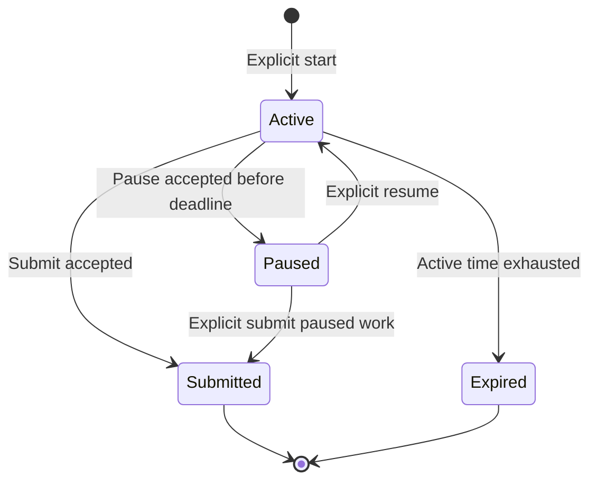

# ANVAYA Assessment pause and paper-subjective specification

Version 1, 11 October 2026. Repository baseline `f859a3c7cdf44baadc17d9bd1a6c656530c1b5bf`.
**Design complete; persistence/UI implementation not yet performed.** Apply no migration until actual installed schema/ledger lineage is verified. Gate A automation and no-migration B1 may proceed independently. No main merge or production deployment is authorized.

## 1. Repository contracts and concrete scope

| Current owner | Verified contract | Required change in its bounded phase |
|---|---|---|
| `services/assessment_package_service.py::_validate_package`, `schemas/anvaya-assessment-package-v1.schema.json` | Strict v1 keys; mode exam/practice; subjective types short_subjective/long_subjective; rubric string required, solution string, no objective key for subjective | Preserve existing wire shape and blind review. Recognize a reviewed structured rubric encoded inside the existing rubric string, with plain-text fallback |
| `repositories/sqlite/assessment_runner_repository.py` | Session snapshot; status CHECK active/submitted/expired; unique active assessment; responses/revisions; original wall-clock expires_at | Add one execution extension per session and one transactional mutation guard; preserve original snapshots and unique in-progress identity |
| `services/assessment_runner_service.py` | Injected aware `now_fn`; server wall expiry; current ordinal and response state; runner_view currently synchronizes expiry and marks visited | Compose effective paused state centrally. Make view queries read-only; explicit navigation/heartbeat commands own visits/expiry |
| `ui/web/routes.py`, `templates/assessment_test_runner.html`, `static/js/assessment_runner.js` | Existing session GET and autosave/heartbeat/action/submit POST; visible response normalization; JavaScript countdown is a display | Add pause/resume and explicit navigate controls; revisions, request receipts and authoritative timing payloads |
| `assessment_evaluation_service.py`, `assessment_evaluation_repository.py`, migration 0012 | Terminal snapshots only; blank response scores unanswered; subjective text awaits review; user/teacher/Alex manual evaluation can become confirmed; rubric hash | Paper attempts must not enter the ordinary blank-response scorer or user-confirmation bridge. Introduce a separately typed self-evaluation source with no official-grade writes |
| `assessment_intelligence_repository.py`, migration 0011 | Confirmed rows carry grading confidence but lack immutable mapping/independence snapshot | B1 reports unknown attribution; later B writer captures actual reviewed provenance. Self-reported marks never satisfy automatic recovery |
| Coding Helper 2 | Signed stateless continuation; server revalidates visible task; no historical assistance records | Block helper while paused; retain UC100N/mode policy and secret-free payload; do not infer independence from absence of logs |

Current application has a local Flask factory and native form/JSON conventions; no shared authenticated-account or CSRF enforcement was found in the inspected factory/runner handlers. Session IDs are identifiers, not credentials. New affected mutation endpoints must enforce same-origin requests and a server-issued session mutation token, with tests for missing/foreign Origin and invalid token. Native forms carry the same token. Do not expose a test-only bypass. This remains a local application; a multi-user authentication system is outside scope.

## 2. Product decisions

- Online practice and assignments: Pause is permitted by a snapshotted server policy. Existing storage mode is practice; assignment is an assessment type, not a new mode enum.
- Exam: Pause is disabled by default. Any permitted accommodation requires an explicit reviewed policy before start, saved into the attempt; it cannot be enabled by a browser field or changed mid-attempt.
- Closing/hiding the tab never pauses an active attempt. The UI says this plainly. Unacknowledged network failure never implies a successful pause.
- Paper-Based Subjective is an explicit attempt kind under practice, available only when **every** question is subjective, the package is approved and solution/rubric review passes. Mixed papers keep the existing runner; no solution endpoint for their objective questions. Exam paper self-check is unavailable.
- Paper answers require no typing, scan, OCR, image, AI call or upload. The workspace presents the full paper, question marks, a question navigator and deliberate per-question attempted-on-paper acknowledgement.
- Solving can use the configured active-time duration and Pause. An explicit Finish solving freezes solve-time and enters self-check in the same workspace. Self-check draft editing has no running examination countdown. The ordinary submitted response snapshot remains immutable.
- Intentional reveal during solving is permitted only for paper practice after acknowledgement; it records that assistance occurred and the reveal time. It never changes an objective/exam policy. The student can reveal later in self-check instead.

## 3. Pause state and server timing

There is no implicit paused→expired transition. There is no resume of terminal work. Submitted and expired remain distinguishable, including submission reason. Remaining active time is not engagement/focus evidence.

Use integer milliseconds with an aware injected UTC clock. Let D be snapshotted duration, C accumulated completed active segments, A the current segment start, and N transaction time:

- Active consumed = min(D, C + max(0, N−A)); remaining = max(0, D−consumed).
- Paused consumed = C; remaining = D−C, independent of wall time.
- Pause stores consumed into C, clears A and saves paused_at atomically.
- Resume preserves C, sets A=N, clears paused_at, and refreshes displayed active deadline N+(D−C).
- Terminalization stores final consumption and freezes all response/review snapshots. Disconnected active time counts; focus-time counters retain their separate bounded-heartbeat semantics.
- Display seconds are ceiling(remaining_ms/1000); only remaining_ms<=0 causes expiry. JavaScript interpolates from server_now and performance.now; it never decides server correctness.
- A backwards server wall clock is clamped for consumption and surfaced as a clock anomaly; it cannot add time. Store last_authoritative_at, reject malformed/naive clocks and use max(N,last_authoritative_at) for mutation chronology. Client timestamps are never used as authority.

## 4. Proposed persistence without rewriting applied history

Allocate migration filenames only after lineage verification; do not assume 0015 is free. Leave 0001–0014 checksums untouched. The preferred small extension avoids rebuilding migration 0011's session CHECK and all referencing tables:

`assessment_session_execution` (one row per existing session, FK RESTRICT/unique):

| Field | Meaning / constraint |
|---|---|
| session_id | PK/FK to original attempt; no new attempt identity |
| execution_version | Positive contract version |
| attempt_kind | online_timed / paper_subjective; immutable once started |
| pause_policy_json, policy_sha256 | Immutable allow/deny/reviewed accommodation snapshot |
| consumed_active_ms | Integer 0..duration_ms |
| active_segment_started_at | Aware UTC text; null iff paused or terminal |
| paused_at | Aware UTC text; null iff active or terminal |
| last_authoritative_at | Nondecreasing normalized clock timestamp |
| package_id_snapshot, package_revision_snapshot, package_sha256 | Actual import/runtime lineage; unknown stays null, never copied from a later revision |
| revision | Positive execution revision, increments for semantic commands |

**Single effective-state owner:** original session terminal status wins; otherwise paused_at non-null means paused, otherwise active. Do not add a second writable status enum. All consumers use a composed header through the runner repository. Original `status='active'` while paused retains the original unique in-progress index, so another Start returns the same paused attempt without resuming it. Original expires_at is a compatibility projection, never the paused clock authority. On resume it becomes the new active deadline. Every expiry/session-list/start/evaluation/helper query must use this composed state; an old reader cannot be left treating stale expires_at as live.

Existing terminal attempts get no execution backfill. An existing active practice attempt can adopt pause only in an explicit transaction that computes already-consumed time from its original wall deadline and records adoption/policy; GET never creates an extension. Unknown original exam accommodation remains disabled. New starts create the extension with snapshots in the existing start transaction.

`assessment_runner_command_receipts`: immutable session_id + request_id unique, command kind, canonical payload hash, prior/result revision, bounded result JSON, occurred_at. Same key/same payload returns its original receipt; same key/different payload conflicts. A replayed receipt is labelled replayed and includes a separately fetched current header, so an old active reply cannot repaint a newer paused state. Persist receipts in the same transaction as the action. Store no answer keys or raw provider responses in receipts.

This extension is execution metadata, not another progress/memory system. New paper attribution and self-evaluation tables below are typed assessment sources. Topic Intelligence remains a computed adapter.

## 5. Central mutation protocol and races

Every autosave, heartbeat, visit/navigation, clear/review action, pause/resume, submit, timeout command, helper context check and evaluation entry uses the same composed state. Commands that write use BEGIN IMMEDIATE, then:

1. Resolve receipt by request_id before revision checks. Reject hash mismatch.
2. Load session/execution/response inside transaction, obtain injected N, verify expected_execution_revision and expected_response_revision when changing an answer. Client-supplied policy/mode/duration is rejected.
3. Compute current effective clock. If active time exhausted, commit terminal expiry/receipt and reject the requested answer/pause as ended. Expiry wins at the exact boundary.
4. Verify command allowed by state/kind/policy; validate the full payload through existing normalization and bounded fields.
5. Mutate atomically; increment execution/response revisions only where appropriate, append existing test event, persist receipt, return persisted state and server timing.

| Race / condition | Exact behavior |
|---|---|
| Autosave already acknowledged, then pause | Acknowledged response remains persisted and included in paused snapshot |
| Autosave still in flight when Pause clicked | UI drains its serial save queue, sends final visible response and revisions with pause. One transaction saves that payload and pauses. Failed save/pause retains visible text and does not claim Paused |
| Delayed old autosave reaches server after pause | 409 paused/stale; no answer mutation. Resume does not make the stale request valid |
| Pause vs submit from another tab | First committed terminal/paused command wins its state; stale loser 409 and reloads. Submit from paused is a separate explicit confirmation with current revision |
| Two simultaneous pause/resume commands | Same request receipt is idempotent; different stale revisions conflict; no second timer segment |
| Retry after response lost | Same request_id/hash returns persisted receipt; UI uses monotonic latest execution revision |
| Old heartbeat/late timer callback while paused | No focus/visit/expiry write; return paused header or 409. Never auto-submit paused work |
| Resume after long offline interval/server restart | Reload persisted responses, current ordinal, review flags, timing and policy; no browser storage dependency |
| Already terminal attempt | Immutable answers/clock. Return summary; no re-open, regrade or second submission |
| Answer from a non-current question/device | Validate membership and expected response revision; navigation is explicit, stale question context conflicts |

GET runner/summary becomes query-only and does not mark visits, persist expiry or initialize data. If computed expiry is due, it renders an ended projection and requires the explicit idempotent timeout/submit command before evaluation. JavaScript/no-JS navigation uses POST visit then redirect; previous and palette controls retain accessible semantics. A worker may later call the same expiry command; no scheduler is required initially.

## 6. Endpoints and UI

| Endpoint | Request / response contract |
|---|---|
| POST /assessments/sessions/<id>/pause | request_id, expected_execution_revision, optional final question response + expected_response_revision, mutation token; returns persisted paused header |
| POST .../resume | request_id, expected_execution_revision, token; returns active header, remaining_ms, server_now, new active deadline |
| POST .../navigate | request_id, target ordinal, revisions, optional drained answer, token; saved visit/navigation only when allowed |
| Existing autosave/action/heartbeat/submit | Add receipt/revision/token contract; all use shared guard. Heartbeat never extends duration |
| GET .../state | Query-only authoritative header/response revisions; no private marking data |

Use typed errors 400 validation, 404 missing/mismatched identity, 409 stale/state conflict, 422 missing reviewed paper rubric/policy, 503 unavailable. No raw SQL, paths or private source errors in responses. Native form responses use existing redirect conventions; JSON content negotiation returns the same contracts.

Runner top bar: title, practice/exam policy, active-time remaining, save receipt time, Pause where permitted, Finish. Pause disables input/actions after server acknowledgement, stops display ticker/heartbeats and shows “Paused — answers saved”, saved-at, frozen remaining time and Resume/Finish paused work. An unacknowledged pause shows retry and preserved unsaved input. Paused question text/review palette can be read; navigating/changing responses requires Resume. Focus moves to the banner on pause and back to the current question on resume. Banner text uses aria-live and actions have labels. No auto-pause on tab visibility.

Preflight/history shows Resume paused practice with the same ID. It cannot create a second active attempt. Exam policy is displayed before Start. The existing MCQ/MSQ, numerical/fill_blank/true_false and math typesetting remain unchanged.

## 7. Paper solve and guided marking workspace

The same session route selects the paper template based on immutable attempt_kind. Layout: paper title/instructions/total at top, readable question cards with marks and “Attempted on paper”; sticky question navigator; optional per-question reveal panel. Mobile uses stacked cards and accessible expandable guides. Ordinary online runner never receives these private panels or their JSON.

Reveal is explicit POST `/assessments/sessions/<id>/paper/questions/<sqid>/reveal`. Verify session ownership, all-subjective practice kind, approved snapshotted policy and attempted acknowledgement (or terminal solve phase), and membership before selecting private fields. Record a test event and assistance flag. Return only that question's snapshotted solution/rubric. Paused solving cannot reveal; resume or finish solving first. Changing URL, course query or DOM cannot authorize reveal. Add Cache-Control: no-store. Sanitize allowlisted Markdown/text/math; never render arbitrary package HTML.

Guides present expected derivation, method/intermediate/final marks, dependency conditions, acceptable alternatives, common errors and explicit no-award rules **only when authored/reviewed in the package**. Do not invent per-step marks from a prose explanation. The author/reviewer, exact rubric hash and package snapshot version are visible.

Structured authoring remains v1-compatible: `rubric` is still a string. Its optional content may be JSON with exact shape `schema='anvaya.subjective-rubric'`, version=1, question_id, total_marks_milli, grading_increment_milli, steps, common_mistakes, review_required. Each step has id, label, expected_work, max_marks_milli, prerequisites (step IDs), award_when, do_not_award_when, allowed_awards_milli and alternative_group (null or a stable ID). Arrays/strings are bounded, IDs unique, dependencies acyclic, total/additive maxima reconcile, alternatives are mutually exclusive and marks are finite integers. No URL/file/SQL/action fields. Its literal text remains usable by old v1 importers. The upgraded importer renders a safe human guide, validates semantic allocations and requires human review; authoring_confidence is not reviewer authority.

If the rubric is plain text, show the complete original solution/rubric and a per-question mark field labelled “No verified step allocation available”. Do not show fabricated method/final buckets. A malformed structured rubric is review-required and cannot silently fall back to trusted structured marks. Fully detailed per-step mode is enabled only after reviewed allocation. Package approval and source provenance gates remain separate from structural validation.

## 8. Self-evaluation persistence, validation and revisions

Do **not** call existing `save_manual_evaluation(confirm_final=true)` for self-marks: its confirmed rows can enter current assessment intelligence. Do not insert fake subjective text merely to avoid the blank-response scorer. Ordinary evaluation entry rejects paper_subjective attempts and redirects to the self-check source.

Proposed typed storage:

- `assessment_paper_question_states`: session_question_id PK/FK, attempted_on_paper, revealed_at, reveal_rubric_sha256, revision. Acknowledgement/reveal is execution state, not correctness evidence.
- `assessment_self_evaluations`: id PK, session_id FK, revision, supersedes_id FK nullable, status draft/submitted, provenance fixed self_assessed, package/rubric snapshot references, created_at, submitted_at; unique(session_id,revision), at most one draft. Submitted revisions immutable.
- `assessment_self_evaluation_items`: (self_evaluation_id,session_question_id) unique, awarded_marks_milli nullable, explicit unattempted flag, marking_mode per_step/per_question, step_awards_json, bounded mistake_reason/confidence/reflection, rubric_sha256 and draft item revision. Never FK-bridge this source into `question_attempts` or official mistake/progress tables.
- Reuse runner/evaluation event conventions for submit/amend receipts; self-grade command receipt includes self_evaluation revision and payload hash. Do not create a separate learner profile or mastery store.

Create a draft through explicit self-check command after Finish solving (original session submitted/expired with frozen responses). Save question marks with expected draft/item revisions, request_id and token. Decimal input must convert exactly to existing integer milli-marks; reject bool, NaN/Infinity, out-of-range, more than three decimal places and values outside the reviewed increment/allowed awards. Range is 0..snapshotted question maximum for paper self-check; objective negative penalties are untouched. Per-step sums are server-computed, prerequisite/alternative constraints enforced, no double-counting method and alternative marks. Per-question mode cannot also add step scores.

The student can save incomplete work and reopen it. Blank score means missing, not zero. Final self-submit requires one explicit score or explicit unattempted acknowledgement for each subjective question and explicit “These are my self-entered marks” confirmation. No hidden zero-fill. Server computes question totals, overall total and percentage using frozen maxima; missing/zero maxima prevent misleading percentage. Optional confidence is labelled self-reported, not grading or mapping trust.

After submission, corrections use explicit Amend: create a new draft revision referencing the previous submitted version, with a required correction reason. Old marks/rubric/receipts stay immutable. Concurrent draft save/amend/submit with stale revision conflicts; identical retry returns the same receipt. A package/rubric edit never changes an existing attempt; a new rubric requires a new reviewed attempt or separately labelled re-evaluation revision, never silent rebinding. Unknown/cross-course/deleted topic mapping remains unresolved and excluded; raw per-question self-marks remain visible.

## 9. Evidence integrity and reports

Every self-grade displays `self_assessed / self_reported`, source session, self-grade revision, rubric/package hashes, reviewer status, reveal history and limitations. Tutor may read these as supporting diagnostics, never as verified independent performance. Teacher validation would be a future separately authorised source, not a status toggle on self-marks.

Self-report recap: awarded/maximum/percentage, explicit unattempted count, question/step losses and student-entered error reasons, by-topic summaries only for known course-scoped mappings, short reflection. Display all questions without mapping in an Unmapped section. Self-reported error reasons are not confirmed mistake events. Source-linked exact online assessment reports remain unchanged and separate.

Topic Intelligence adapter carries source kind self_assessed and `independence=assisted_or_unknown`, exclusion reason `self_reported_outcome`. It cannot qualify for policy v1 negatives, spaced-success override, established breadth, trusted mastery or automatic recovery. It may inform an explicitly student-requested review, clearly labelled. Stored mastered flags, official grades, progress snapshots and normalized independent attempts are untouched.

Policy v1 remains inclusive 28 days, attempted poor ratio <0.60, >=5 independent poor identities across >=3 sessions and >=2 local dates, recent poor within 7 days, cohort mean <0.60, reviewed mapping >=0.90, declared grading <0.75 excluded; success override >=3 new >=0.80 identities over >=2 independently separated sessions >=24h after latest negative. None of these conditions can be met by self-grade rows.

## 10. Test and rollout gates

| Phase / dependency | Concrete files and tests | Required acceptance |
|---|---|---|
| AP0 — this conversation | This spec, A harness and plan addendum; actual runner/package/evaluation/UI inspection | Design PASS; no claim that Pause or paper UI ships |
| AP1 — verified lineage + A development | New additive execution migration; runner repository/service; runner JS/template/routes; `test_assessment_pause_clock.py`, `test_assessment_pause_transactions.py`, JS state tests | Active/paused/terminal boundaries, same ID, no double segment, policy snapshot, original answers/exact scores unchanged |
| AP2 — AP1 | `test_assessment_pause_browser.py` with synthetic server restart and injected clock | Pause, close browser, advance hours, restart server, Resume: unchanged remaining active time, answers/navigation/review state. Two tabs, aborted/delayed requests, stale callbacks, keyboard/mobile and no-JS forms |
| PS1 — B provenance contract + verified lineage | New typed self-grade migration; `domain/assessment_self_evaluation.py`; paper service/repository; reviewed rubric parser; package validator/schema documentation | Strict structured rubrics and fallback, no blind leakage, canonical identity/versioned provenance, no official bridge writes |
| PS2 — PS1/AP1 | Paper workspace template/JS/routes; `test_paper_self_evaluation.py`, `test_paper_reveal_policy.py`, `test_paper_revision_integrity.py`, `test_paper_browser.py` | No required textarea; per-step/per-question partial marks, bounds, incomplete save, final confirmation, revision/retry/race handling, mobile long-guide scrolling |
| Compatibility proof | Existing Phase B/C/D/E/F, import/blind review, math/fill-in, Coding Helper/Node/browser and complete A validator Ubuntu/Windows | Old exact scoring and package v1 stable; self-grade reads cannot satisfy v1 policy or mutate progress |

AP1 deterministic test IDs include `test_pause_freezes_active_time_after_restart`, `test_exam_pause_disabled_even_with_forged_payload`, `test_pause_at_exact_deadline_expires`, `test_acknowledged_autosave_survives_pause`, `test_final_pause_payload_saves_atomically`, `test_stale_autosave_after_resume_rejected`, `test_receipt_replay_cannot_restore_old_active_header`, `test_multiple_devices_conflict`, `test_paused_submit_idempotent`, `test_helper_disabled_while_paused`, `test_get_paused_state_has_no_logical_write`, and `test_existing_active_session_adoption_records_consumed_time`.

PS tests include `test_reveal_never_exposes_objective_exam_keys`, `test_plain_rubric_does_not_invent_step_marks`, `test_bad_structured_rubric_needs_review`, `test_decimal_bounds_and_alternative_steps`, `test_incomplete_draft_reload_not_zero`, `test_self_submit_amend_preserves_previous_revision`, `test_rubric_revision_does_not_rebind_attempt`, `test_self_marks_do_not_create_independent_evidence`, `test_self_success_cannot_suppress_recovery`, `test_long_solution_keyboard_mobile_scroll` and nth-write transaction rollback/FK checks.

Migration rehearsal uses only disposable synthetic/stable copies, applied checksum parity, table/row/FK/index/snapshot comparisons and transaction fault injection. No migration at startup/GET. A stable production schema report is a dependency for designing executable migration names, not a reason to stop A or no-migration B1.

Rollback: feature-disable **new** extended attempts while retaining additive history. Already paused/paper attempts must remain readable by the new compatibility reader; do not downgrade to the old wall-expiry code while paused attempts exist. Resume/finish them explicitly before old-version rollback. Never destroy self-grade revisions or restore a backup over later student work. No merge/deployment is authorised by this specification.
