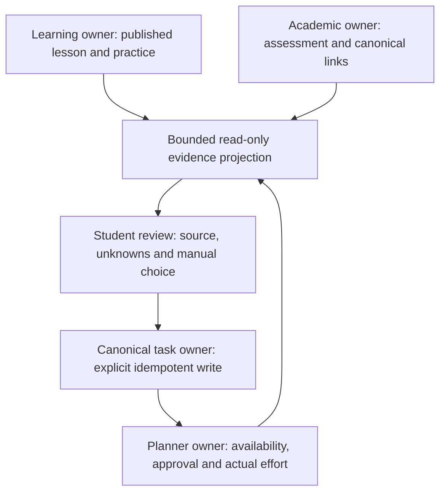

# Architecture V2.3 — safe academic evidence development slice

This dedicated feature branch starts from merged main `dd10397ee373f07fd16f110c4eed399059cc3c4a`. Library V2 remains merged and preserved. PRs #27, #29, #20, #13 and #9 are not merged by this work. No deployment or main merge is authorized.

## Delivered behavior

- Selectively reconcile Architecture V2.2 onto the actual Library main: bounded private-fixture staging, conservative Topic A/D diagnostics, exact B3 recovery namespace, terminal Assessment result/error paths, and original availability/timezone/clock approval context.
- Add immutable `anvaya.academic-evidence.v1` projection with explicit policy version, module/source SHA/page and exact question/revision/event references. Source integrity means published snapshot bytes; live registry freshness and semantic correctness are separate unknowns.
- Practice remains a low-stakes study signal with unknown assistance/independence. Repetition, self-scores and task completion never establish independent mastery, official grades or automatic recovery eligibility. Historical Assessment source/mapping remains unverified. Future or malformed grading clocks block affected evidence. Actual effort is admitted only when each contributing completed event has valid created/update/completion clocks at or before the snapshot; an unqualified event withholds the total rather than producing a misleading partial sum.
- Read canonical and Learning stores only through bounded RAM snapshots. DELETE captures reuse the merged Library descriptor/header/sidecar/stability guards. WAL requires the existing owner-authorized in-memory publication. No live SQLite connection, checkpoint, migration or source-loader call is introduced by the new read projection.
- Add a separate dark Study Evidence workspace: faithful authored definitions, tables, worked examples, graph relationships, owned images, ungraded activities, recall prompts and revision material with page review reasons. Recall answers and assessment keys are withheld. Original source/owned images remain accessible independently of evidence inventory problems.
- Add a signed, expiring manual study preview. GET does not write. Explicit confirmation calls the existing canonical task owner with an idempotent UUID receipt and exact active course/topic/name revalidation inside the writer transaction. It creates one P2 backlog task and preserves completed receipts on retry.
- Preserve the original Planner workflow: explicit available window → preview → save draft → separately approve → record actual effort. Every HTTP approval is bound to the reviewed planner fingerprint, including unscheduled drafts. Planning does not invent free time.
- Add a versioned, bounded offline Tutor handoff that uses exact source pages and authored explanations. It creates no Tutor session, calls no provider and claims no automatic Tutor consumer.
- Add a real three-page synthetic UC100N-style PDF demonstration with case/variable distinctions and a worked mean of scores 8 and 6: (8+6)/2=7. It exists only in disposable test owners; it is not an import of an actual academic course.

## Ownership decision (ADR)



Each write remains with its existing owner. No parallel academic database, grade book, alternate task table or schema migration is added. The read model deliberately does not claim an atomic snapshot across two databases. A later writer-side mapping check prevents a stale read from authorizing a different course/topic pair. Source/practice changes invalidate the reviewed intent fingerprint; Planner-only receipts do not invalidate an idempotent retry.

A source PDF is validated independently of attempt qualification so a large or malformed evidence inventory cannot remove the source needed for review. Owned image routes accept bounded validated asset basenames; no arbitrary filesystem path or remote content is accepted.

## Reproducible acceptance

The `Architecture V2.3 academic evidence acceptance` workflow records head, tree and native platform in `source.json`. It requires every focused file to exist, rejects all focused skips, runs the whole repository with real Chromium, Node tests, compilation and source hygiene, and uploads XML/logs and screenshots. The only full-suite skip allowance is the four exact original private IKS test identities already documented by the strict validator; skipped checks are never counted as passes.

Real browser cases exercise 390, 768 and 1366 widths and a mobile no-JavaScript read/preview/explicit-consent path. The complete source→wrong answer→exact evidence→manual linked task→availability→draft→approval→35-minute completion→updated evidence journey runs against disposable canonical and Learning owners. Official assessment marks stay unchanged and no synthetic study session is fabricated.

Screenshots include the actual unchanged owner reader (`original-reader-*.png`), additional V2.3 lesson view (`v23-lesson-*.png`), completed evidence and a review contact sheet. These are browser captures of synthetic content, not generated mockups. Source and screenshot artifacts are linked from draft PR #31. The latest exact-head CI results, not historical totals, determine acceptance.

## Explicit blocked gates

1. **Original private IKS cross-platform acceptance: BLOCKED.** Genuine trusted external fixture prerequisites are unavailable. Original tests remain intact; the strict architecture validator must not turn their absence into a pass. The private workflow remains dispatch-only and gated; no private PDF/package is uploaded or reconstructed.
2. **Installed Windows/B3/WAL authority: BLOCKED.** Hosted Windows synthetic tests do not certify an installed database, owner lifecycle, exact B3 integration or production WAL publisher. Existing strict owner authorization remains required.
3. **Independent academic certification: not established.** Authored fidelity flags are shown with their reasons. The synthetic example and unit/browser tests verify deterministic behavior, not curricular coverage or independent learning outcomes.
4. **Automatic Tutor consumption and automatic remediation: unavailable.** The handoff is manual and read-only; no provider/session or recovery mutation is added.

These limitations do not authorize bypassing merge protections or merging unfinished Architecture V2.2 branches.

## Local review and rollback

Use an isolated checkout of the dedicated branch and Python 3.12. Install the tracked development dependencies and Chromium:

```sh
python -m pip install -r requirements-learning-studio.txt -r requirements-assessment-browser.txt
python -m playwright install chromium
ANVAYA_ASSESSMENT_EXTENDED=false python phase7_web.py
```

The normal main launcher already supports optional Assessment activation. The command above disables that existing activation while reviewing this feature; it does not apply migration 0015. In PowerShell set `$env:ANVAYA_ASSESSMENT_EXTENDED='false'` before `python phase7_web.py`. Read pages can remain unavailable until an existing authorized owner is configured; do not create an academic database to satisfy a read.

For automated validation set `ANVAYA_BROWSER_TESTS=1` (PowerShell: `$env:ANVAYA_BROWSER_TESTS='1'`) and run `python -m pytest -q`. The focused file list is explicit in the V2.3 workflow. All new fixtures use temporary databases; do not point fixture or validation commands at installed academic records. Normal read-only pages report unavailable when an authorized source snapshot is absent. Do not run migrations or import a pilot merely to make a read page appear available.

Set `ANVAYA_EVIDENCE_ENABLED=0` before application startup to disable the new workspace and navigation. An already constructed Flask app can set `ACADEMIC_EVIDENCE_ENABLED=False`. Disabling the feature preserves canonical tasks already explicitly created through the owner. Rollback requires no schema reversal or academic data deletion; revert the feature source through normal Git review. Local task receipts remain ordinary canonical tasks.

## Next phase, in priority order

1. Obtain the genuine private IKS fixtures and owner-authorized installed Windows/B3/WAL evidence in their original protected environment; rerun exact-head acceptance without relaxing any gate.
2. Review source fidelity and versioned exact mappings with an academic reviewer, then define independent recheck evidence, evaluator provenance and as-of revisions before considering stronger qualification.
3. Add a separately approved, module-bound Tutor consumer with explicit consent and audit trail; preserve source context and unknown assistance. No automatic provider calls are implied by the current handoff.
4. Improve inventory pagination and revision comparison once the bounded baseline is verified. Any cross-feature schema/integration work needs a separate design and authorization.
