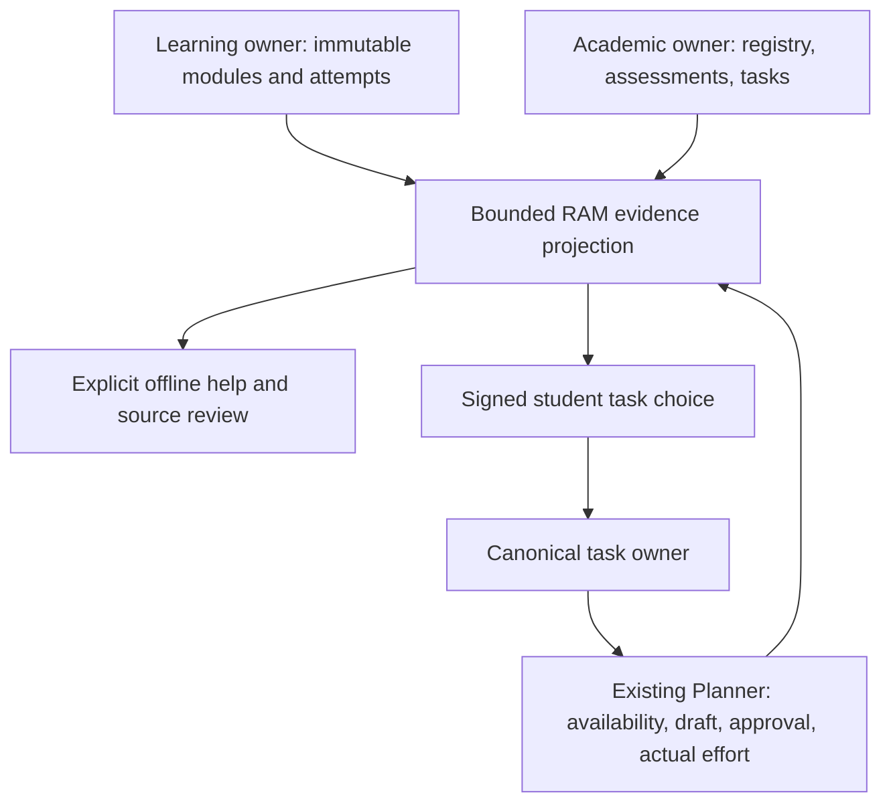

# Architecture V2.4 — reviewed learning-intelligence increment

Base: merged main `bf3ca0e7eb1bf6f51d900ab4a6cc69ca83a61eae` (PR31). This branch is not permission to merge or deploy.

## Implemented ownership and contracts

`anvaya.topic-reference.v1` encodes the canonical `(course_id,topic_id)` tuple with a SHA256 key and `academic_registry` owner. Display names never determine identity. This is an adapter, not a new registry. It is additive to `anvaya.academic-evidence.v1`; existing evidence policy and unknown mastery fields remain intact.

The Learning side of a response is captured once through the existing bounded stable DELETE/RAM owner adapter. The academic owner is independently captured; no atomic transaction across owners is claimed. Existing task writer validates the active course/topic/name in its own transaction. Signed expiring previews bind the evidence fingerprint. Changes to attempts, mappings, source revision, or revision/reflection metadata require a new preview. An idempotent task retry still uses the existing canonical UUID receipt; no new table or migration exists.

Revision-view events now appear separately as `learning_revision`/`revision_signal`, with exact event identity, immutable module revision, original source hash and timestamp. The owner event does not persist its actual rendered budget selection. Page-level attribution is therefore unknown (`rendered_revision_selection_not_recorded`), with a document link rather than guessed section-page citations. Opening revision is not a completed recheck. The budget is not actual effort. Reflection/recall metadata uses `learning_reflection`/`self_reflection_signal`; private reflection text is never projected. Assessment, task and effort clock order now fails closed, in addition to individual clock/as-of validation.

## Student experience

The actual Learning Studio Learn page gains a readable dark lesson composition, a native authored-content outline, source-linked definition/example/misconception blocks, a local lesson practice checkpoint and a direct evidence journey. It preserves the same authored text, original images, equations-as-authored, Markdown tables, module IDs, templates and progress controls. Text-size preference remains inherited. Focus Reading only carries its preferences to Learning reader URLs, never to strict cross-owner routes. Staged navigation stays staged and cannot practise before publication.

After a qualified exact practice mistake, the learner can explicitly request a source-grounded hint. `anvaya.grounded-offline-help.v1` contains the exact event/question/revision, stable topic reference, evidence fingerprint, as-of clock and source page links. Hint → concept → example → self-check are separate native POST actions. Generic prompts are domain-neutral and labeled deterministic; authored excerpts remain labeled authored/untrusted, scoped to the exact question pages. No guessed diagnosis is presented. Missing matching content is visible. The self-check returns to the exact question; a later correct retry does not certify independence.

This is a stateless offline consumer of the frozen educational projection. It deliberately does **not** claim compatibility with automatic course-scoped Tutor sessions, consume arbitrary client handoff JSON, call a provider, store assistance metadata, or retroactively mark practice attempts independent/assisted. Previous and future attempt assistance remains unknown. Automatic session integration is unfinished V2.4 scope, requiring an immutable source-bound canonical session owner contract.

## Review-first conversion slice

An explicit signed POST extracts the already-published original PDF into temporary `anvaya.note-draft.v1`. A separate parser process receives bytes through stdin, inherits no provider/credential variables, has a 12-second timeout, and reads no application stores. Input: <=8 MB and <=50 pages. Text: <=30,000 characters/page and <=100,000 total; output bounded. POSIX applies CPU/address-space limits; Windows has timeout/input/output bounds, not a memory limit. This is process isolation, **not** an OS sandbox for arbitrary malicious uploads. The route only accepts existing registered published source bytes; no new public upload surface is added.

Each page preserves extraction order/text, exact source SHA, extracted-text SHA, parser/method and unknown semantic confidence. Original page links, incomplete/OCR/figure/math/table warnings and a review outline accompany it. Native forms work without JavaScript. The preview cannot stage or publish; human source comparison/re-authoring must use the existing owner preflight → stage → publication flow. Automated structured conversion approval/publication, PPT/PPTX parsing, complete math/figure reconstruction and scanned-page OCR remain unfinished. No private IKS import or background conversion occurs.

## Verification and rollback

Focused test files are listed in `.github/workflows/architecture-v24-intelligence.yml`. It records the exact head/tree/platform, runs the unchanged main V2.3 browser journey to capture genuine before screens, restores exact feature source, then runs new contracts/browser tests and the full suite on Ubuntu/Windows. Public acceptance uses the existing strict test-status/external-pilot identity functions; exactly the four original external private identities may be skipped. Missing, duplicate or unexpected identities/skips cannot pass. Private original certification and installed Windows/B3/WAL authority remain BLOCKED, not synthetic passes.

Browser journey: actual Learn → wrong answer → exact evidence → offline hint/concept/example → self-check retry → PDF draft inspection → explicit task preview/creation → student-supplied availability → draft → separate approval → 35 actual minutes → updated evidence/Analysis. Viewports: 390,768,1366. Includes no-JS help/draft, text-size/Focus Reading regression and full inherited Assessment palette pause/resume browser coverage. Practice submission still needs JavaScript, inherited from its owner; no full no-JS learning loop is claimed.

Local Chromium download succeeded but this container denies browser Unix sockets (process singleton), so local browser launch is BLOCKED. Native GitHub runners are the actual browser/Windows verification authority. Local unit/HTTP, Node and compile results are separate; final run URLs and counts belong in ACCEPTANCE.md and the PR after the runs finish.

No database migrations, WAL checkpoints, imports or installed-data writes are introduced. Original-file access remains independent. `ANVAYA_EVIDENCE_ENABLED=0`/app `ACADEMIC_EVIDENCE_ENABLED=False` disables the evidence/help/draft routes. The original `python phase7_web.py` startup remains. Revert the branch through normal Git review to undo code; canonical tasks explicitly created by the student remain ordinary owner tasks and must not be deleted by rollback.

## Independent review and fixed findings

Three separate reviewers inspected engineering/data safety, academic provenance, and frontend/accessibility. Their findings led to red→green regressions for revision page uncertainty, generic hint domain neutrality, and reversed assessment clocks; fixes also preserve text-size inheritance, focus URL boundaries, lesson-mode question selection and staged routing. Browser tests verify the dynamic control fixes on native CI. Reviews do not certify private course fidelity or installed authority.

## Remaining V2.4 / V2.5 handoff

These items are **unfinished V2.4 capabilities**, not completed features relabelled as V2.5:

| Capability | Owner/prerequisite | Next acceptance |
|---|---|---|
| Durable Tutor assistance attribution | Tutor/learning owners: immutable module/source/question session binding and approved metadata write | explicit consent + retry receipt + bounded history + assistance event → evidence |
| Complete reviewed content conversion/publication | Learning owner and academic reviewer: structured transformation/source-map contract | PDF/PPTX figures/math/OCR, exact page mapping, human edits/approval → separate publish |
| Independent recheck | Assessment owner: authenticated independence/evaluator provenance | help-aware repeated rechecks remain distinct from unaided results |
| Registry freshness/re-import lifecycle | Source registry/Library owners: versioned current-vs-published identity | stale original/re-import comparison and provenance-preserving migration |
| Live installed Windows/B3/WAL acceptance | installed owner-authorized publication and genuine backup/restore evidence | trusted private native runner, no live checkpoint |
| Real-course source certification | private original fixtures and academic review | all four unchanged original IKS tests pass privately; no actual course import implied |
| Deeper Library/search integration | existing Library/Knowledge adapters after this slice is accepted | discover exact lesson/evidence links without a parallel index |
| Native no-JS practice submission and rendered math | Learning reader owner, separate exact source formatting contract | keyboard/server submission + offline math rendering + overflow/semantic tests |

V2.5 should begin with owner decisions for these interfaces and new tests, preserving this increment's read-only and consent boundaries.
