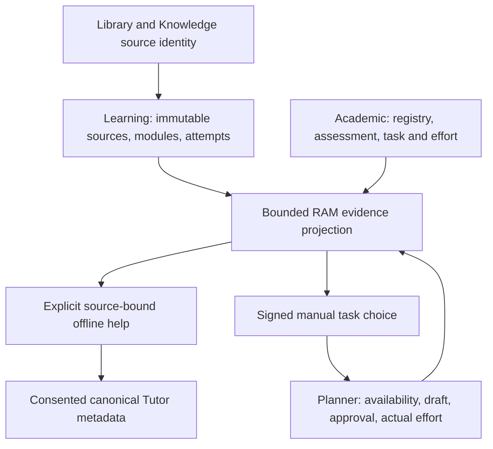

# Architecture V2.4 — integrated academic learning intelligence

Base: main `bf3ca0e7eb1bf6f51d900ab4a6cc69ca83a61eae`, PR31. Dedicated PR33; parallel Tutor reconciliation is preserved. Merge/deploy requires separate owner authorization after final mandatory acceptance.

## Owner boundaries

`anvaya.topic-reference.v1` binds canonical course/topic IDs, never display names, with a stable SHA256 tuple key. It adds no registry/store. `anvaya.academic-evidence.v1` distinguishes practice, assessment, subjective self-evaluation, revision, reflection, planned tasks and actual effort. No grade or independent mastery is inferred from reading, help, retries or time.

Academic and Learning owners are independently captured through existing guarded RAM snapshot adapters; no cross-owner atomic transaction is claimed. Exact source/module/question/event identity, revision, evidence fingerprint and distinct clocks bind actions. Stale/reversed/future context fails closed. Revision-open events cannot identify exact rendered selections, so page attribution remains unknown and document-level; opening revision is not a completed recheck. Reflection metadata excludes private response text. Existing task owner revalidates the canonical mapping in its transaction.

## Reader and complete practice journey

The actual Flask/Jinja reader presents authored definitions, examples, semantic headings, callouts, figures/captions, tables, native collapsed outline, source citations and selected-lesson practice/evidence navigation. Original files, assets, modules, templates and completed activities remain preserved. Mobile spacing keeps the first concept visible, text preferences remain inherited, and sidebar/Focus Reading expansion stays fluid.

Explicit authored math uses bounded local MathML, with arithmetic, Greek/comparison symbols, fractions, roots and scripts. Unsupported, oversized or malformed syntax is escaped and visibly requires review. No external renderer/provider is used. Long equations scroll in a keyboard-focusable region within reader/evidence/help pages.

Practice supports the original JSON interface plus native POST/303/GET forms. Server validation binds CSRF/origin, module/source/question revisions, selection and retry ID. Read-only `attempt_feedback` verifies the actual owner event, question and stored outcome against immutable authored content; no pre-attempt grading key is revealed. Links preserve exact lesson/question/practice context.

An exact eligible mistake can explicitly request `anvaya.grounded-offline-help.v1`: hint, concept, example, then self-check. Prompts are domain-neutral and deterministic; authored excerpts are untrusted and scoped to exact question pages. Missing context stays explicit. A retry does not establish independence.

The unchanged canonical task workflow continues: selected source-grounded action → genuine user-supplied availability → preview → draft → separate approval → actual effort → refreshed evidence/Analysis. Assessment question-palette pause/resume, stopped timer, saved answers and last-question resume remain guarded by existing full-suite browser tests.

## Optional canonical Tutor receipts

A separate signed review and consent checkbox saves minimal `anvaya.learning-tutor-session.v1` metadata through the existing Tutor owner. It includes exact module/source/question/event/topic identities, assistance level, review time and fingerprint; no answer, source text, private notes, transcript or provider call is stored.

Every configured/default writer verifies its actual `PRAGMA database_list` main identity against the academic database; foreign colliding IDs, aliases, in-memory/attached stores and unsupported owners fail closed. Default explicit POST reuses the existing canonical file in `mode=rw`, with no bootstrap/migration. Its precise UTC clock avoids whole-second truncation ordering errors. Mapping validation and deterministic receipt handling occur in the existing owner transaction; exact retries return one record and conflicting retries fail.

GET uses the guarded RAM image, never a writer. Saved help observations are an evidence sidecar outside the academic fingerprint, so saving does not invalidate its own retry. History is bounded before JSON parsing and revalidates actual eligible event/question/revision/source/page/time association. Unavailable or over-bound history is explicit. Receipt assistance describes that approved help view only; historical and future attempt assistance, independence and mastery remain unknown.

## Review-first PDF conversion

Native forms explicitly extract an existing published PDF, show page-ordered editable notes with exact original-page fallback links, require per-page comparison/review and separate staging consent, then open the existing staged preview for independent publication approval. No arbitrary upload/private import/background conversion is introduced.

The existing parser subprocess is bounded to 8 MB/50 pages, 12 seconds, limited text/output and no inherited credentials. POSIX adds CPU/memory limits; Windows uses timeout/input/output bounds. This is process isolation, not an operating-system sandbox. OCR, PPT/PPTX, faithful figures and complete math/table reconstruction remain explicitly unsupported.

`anvaya.note-draft.v1` and the appended immutable source map retain original SHA, page order, extraction/edited hashes, method/parser and unknown confidence. Review uses an independent private signing key, expiry, CSRF digest and source/parent/mapping binding. Request caps apply before parsing; repeated scalar controls, unknown fields, duplicate JSON keys and query ambiguity are rejected.

Learning `stage(expected_parent=...)` checks the published parent digest, exact original bytes and next revision before writing in the existing transaction. Exact immutable receipt retries work; changed parent/target conflicts fail. Original pages, sections, questions, assets, source bytes and history are preserved. Human-reviewed transformed notes are appended, explicitly not verbatim, with unknown confidence and `needs_review` references even if the original page was verified. Publication revalidates through its existing owner; no cross-owner atomic registry claim is made.

## Existing Library and Knowledge discovery

Exact visible PDF ID/hash links from Library resource documents and the Knowledge reader find active published lessons and evidence. Existing Knowledge search continues through its canonical reader; no alternate vault/index is introduced. The bridge uses one academic registry/catalogue snapshot and one frozen Learning image, validates actual reader namespaces, current topic mapping and original source integrity, and bounds inventory/pagination. Archived-only, stale, hidden and cross-database sources cannot acquire links through name matching.

## Verification, reviews and rollback

The V2.4 workflow checks out the exact PR head, records head/tree/platform, captures genuine merged-main before screens, restores feature source, then runs zero-skip focused acceptance, full regression and Node/compile/hygiene on native Ubuntu/Windows. The four original IKS test bodies remain unchanged; public acceptance permits only their exact missing-private skips, with strict missing/duplicate/unexpected identity rejection. Final counts/SHA/run URLs are recorded in PR/evidence only after real runs finish.

The cloud workspace was pruned during an earlier unpublished full run; that interrupted run is not acceptance. Changes were rebuilt from published source, retested and independently reviewed. Native Chromium now works locally. Actual no-JS journeys at 390/768/1366 cover mistake → help → consented receipt → correct retry → edited PDF notes → stage → separate publication → Knowledge discovery. Long-math keyboard/overflow checks and the original seven-width reader regression are included. All demonstrations use disposable synthetic stores.

Independent engineering review found and fixed conversion parse-limit ordering and ambiguous request fields; its original >500 KB exploit now returns413. Academic review fixed transformed-note fidelity and forged receipt/event attribution. Browser/UX checks fixed mobile first-screen spacing, long math containment, real Tutor form action and obsolete pending-help copy. Original functional assertions remain substantive. UI responsive tests wait for the page load lifecycle rather than unrelated background tracking network-idle.

No migrations, checkpoints, database replacement, installed-data test writes or provider calls occur. Existing `python phase7_web.py` startup remains. `ACADEMIC_EVIDENCE_ENABLED`, `LEARNING_TUTOR_V24_ENABLED` and `LEARNING_SOURCE_LINKS_V24_ENABLED`/`LEARNING_LIBRARY_ENABLED` preserve feature boundaries. Rollback is a reviewed code revert; explicitly created canonical records must not be deleted as part of rollback.

## Later scope and external authority

| Capability | Prerequisite and next real acceptance |
|---|---|
| PPT/PPTX, scanned OCR, faithful figures/math reconstruction | Format-specific parser/source-map contract; adversarial extraction, human edits and separate publication |
| Independent recheck certification | Assessment owner authenticated evaluator/independence provenance; help-aware retries stay distinct |
| Provider-backed source-bound Tutor | Separate Tutor branch and configured permission; source/question/privacy/injection tests and genuine provider evidence |
| Re-import/revision comparison/course migration | Registry/Library/Learning lifecycle ownership, side-by-side immutable provenance and rollback proof |
| Installed Windows/B3/WAL authority | Owner-authorized trusted runner and genuine backup/restore without live checkpoint |
| Real-course certification | Genuine private originals; all four unchanged IKS cases pass privately |

These external/later capabilities remain separate from public V2.4 synthetic development acceptance. No passing synthetic check certifies them.
