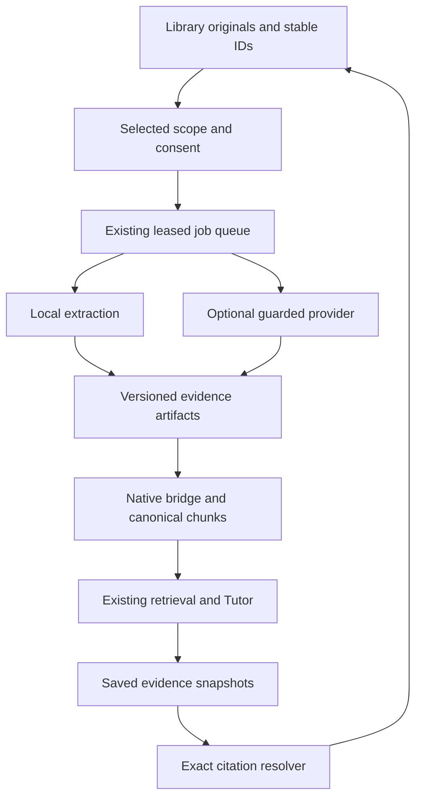

# ANVAYA 3.0 — Multimodal Tutor Phase 1 implementation blueprint

**Finalization check: 13 November 2026 (Asia/Kolkata).** GitHub main was rechecked and remains `fea82a2d2d16c9ae8bec8f262da4fb6087e4f21b`; the original 12 November code audit baseline is unchanged.

**Design recommendation, not an implemented feature.** Baseline: current main `fea82a2d2d16c9ae8bec8f262da4fb6087e4f21b`, audited 12 November 2026, Asia/Kolkata. Read the companion feasibility audit for evidence and external references. All new names below are proposed unless marked existing. User approval to implement is conveyed by submitting the companion Sol prompt; this audit itself authorizes no code changes or spending.

## 1. Scope and release slices

**Slice A — required:** existing Library original → selected image or PDF page → local inspection/optional consented vision → versioned evidence → existing Tutor → exact source citation, uncertainty and recovery. Preserve digital PDF/PPTX text support and correct slide ordering. PPTX image-only slides may use a user-exported slide PNG/PDF attached with explicit provenance; automatic faithful slide rendering is not required.

**Slice B — required pilot after A:** authorized SRT/VTT plus a small explicit frame manifest, timestamp retrieval and citation navigation in the same Tutor. No ASR, video decoder or external fetch is necessary for this slice. A supplied transcript without timing remains usable, but cannot answer an exact-time request with invented times.

**Slice C — optional expansion:** ≤10 minute local authorized audio/video, optional ASR adapter, sparse frames and a safe player. Ship only if process containment, timing, quality, licensing and Windows install gates pass. If unavailable, complete A/B and disclose C as deferred.

Must-have: identity/version/locator contract; consent/budget enforcement; bounded jobs; source-only behavior; exact citations; uncertainty; backup and feature-off behavior; synthetic evaluation; real browser checks. Nice-to-have: bounded crop UI, transcript search, selected-frame previews, deterministic row-operation validation. Defer: automatic full slide renderer, full lecture archive, image embedding index, mandatory PyTorch/GPU, streaming audio, autonomous academic writes, public deployment and Android.

## 2. Architecture and ownership



Do not introduce Celery, Redis, a separate vector service or a new chatbot. Extend `NativeTutorBridge` and its existing `processing_jobs` owner. Keep one worker per local app process with durable leases protecting against accidental second processes; turn off Flask reloader as the launcher already does. Heavy parser/decoder execution occurs in supervised child processes, not an unkillable web-request thread. A thread queue alone cannot safely terminate blocked native parsing.

### Owner map

| Owner | Authoritative contents | Allowed Phase 1 writes |
|---|---|---|
| Native Library | Immutable originals, placements/folders, source links/pins, permissions, user annotations and review decisions | Existing upload/metadata commands; additive evidence/consent/job metadata under this owner |
| Canonical academic DB | Academic records, canonical knowledge registry/chunks, Tutor sessions/history | Existing registry/ingestion publication; existing Tutor exchange persistence; additive per-turn evidence snapshots only |
| Retrieval directory | Derived lexical/semantic generations | Rebuild through existing builder; never authority for originals or consent |
| Learning Studio | Lessons, attempts, reading state | No implicit writes; retain existing explicit handoff APIs |
| Assessment / Planning / Analysis | Grades, attempts, task execution, scoped evidence views | No new automatic writes; preserve current owner contracts |
| Notes / Obsidian | User notes/assets, external vault and companion identities | Read selected authorized material through owners only; no vault edits or inferred mastery |

Derived bytes may be rebuildable, but *user corrections and consent receipts are not*. Store them distinctly and include them in backup. A deleted remote lecture cannot necessarily be reconstructed: preserve uploaded transcript/frame originals if the user chose to retain them, and label an external-only reference as such.

## 3. Verified change map

All paths in this table exist at baseline except explicitly labeled new. Do not edit the whole module merely because it appears here.

| Existing path / symbol | Targeted change |
|---|---|
| `services/native_document_formats.py:MIMES, validate` | Add bounded passive SRT/VTT validation for B; optional media formats only for C. Fully decode raster headers under pixel bounds for processing, not just signature checks. |
| `services/native_document_extraction.py:extract_pages, _slides, _pdf_text` | Preserve text fast path; expose structured selected-page/slide units; route image/scan requests to new service only after explicit scope. Share correct presentation ordering with legacy adapter. |
| `ingestion/extractors.py:PPTXExtractor, TranscriptExtractor` | Reuse safe slide-order implementation; strengthen strict timing/cue/size validation; preserve existing interface and backward tests. |
| `domain/ingestion_models.py:ExtractedUnit`; `ingestion/chunking.py:prepare_chunks` | Carry compatible versioned locator fields; avoid splitting matrix blocks when feasible, otherwise mark continuation and retain parent unit. No breaking rewrite of locator encoding. |
| `services/native_tutor_bridge.py:_claim, run_pending, _publish_native, _publication_is_current, _refresh_retrieval` | Select structured evidence publication; include recipe/artifact/consent revisions, lease fencing, cancellation and recoverable stage checkpoints; keep plain-text publication working. |
| `services/native_library_migrations.py:migrate, validate_schema`; `services/native_document_library.py:NativeDocumentLibrary` | Add explicit backup-first optional activation path for new tables/columns. Keep ordinary old Library behavior safe before activation; do not blindly bump schema beyond old reader support. |
| `repositories/sqlite/ingestion_repository.py:commit_extraction`; `services/unified_ingestion_service.py:ingest_document` | Retain canonical publication transaction; ensure recipe changes and artifact revisions invalidate extraction. Do not fork knowledge tables. |
| `repositories/sqlite/retrieval_source_repository.py:active_records`; `retrieval/hybrid.py:HybridRetriever.search` | Verify media evidence is current/allowed, include temporal/asset identity in dedup key; no hash-only cross-placement permission broadening. |
| `retrieval/rag_context.py:_source_label, _compact_provenance, assemble_context` | Include page/slide/image/time and evidence status in bounded prompt context; keep mandatory provenance even if text is truncated. |
| `tutor/grounding.py:TutorGroundingPlanner, build_provider_request` | Exact selection/time overlap before normal ranking; evidence kind and uncertainty in prompt; source-only vs source-first separation. |
| `tutor/source_freshness.py:source_snapshot` | Validate artifact recipe/revision/retention/consent at preflight and post-response; old text-only records retain current behavior. |
| `services/grounded_tutor_service.py:answer, _answer` | Use the existing transaction/idempotency path; persist validated per-turn evidence snapshot with exchange; guard every provider call including repair/retry calls. |
| `tutor/http_provider.py:OpenAICompatibleTutorProvider` | Shared guarded call layer with output caps, safe errors, provider identity and usage accounting; preserve existing injected provider protocol for regression tests. |
| `vision_math_reader.py:transcribe_image_bytes` | Reuse rendering ideas via a new guarded adapter; do not expose existing raw response/error behavior directly. Leave CLI compatibility intact. |
| `services/academic_agent_web_service.py:ask, session_view` | Bind selected evidence to current session; enrich saved evidence with server-generated exact links; never derive old-turn locations from a newly reused chunk alone. |
| `ui/web/routes.py:academic_agent_ask`; `templates/agent_session.html` | Keep existing ask route/history; extend explicit selection and display evidence badges; replace generic citation destination only when safe snapshot is available. |
| `ui/web/native_library.py:protect, open_document, preview`; `templates/native_document.html` | Selected page/image action, status/coverage/error controls, original-preserving navigation. Maintain external PPTX fallback. |
| `services/tutor_coding_service.py:consent, ask`; `ui/web/tutor_coding.py` | Preserve existing source/provider allowlist. Share lower-level validator where suitable, no consent auto-upgrade or coding regression. |
| `ui/web/learning_tutor_v24.py`; `services/learning_tutor_session_v24.py`; `ui/web/learning_source_links_v24.py`; `ui/web/pao_sources.py` | Verify exact identity handoffs remain compatible. Add no automatic cross-owner mutations. |

Proposed new modules under `personal_learning_assistant/`: `domain/multimodal_models.py` (typed contracts); `services/multimodal_evidence_service.py` (stage orchestration and manifest); `services/provider_permission_service.py` (review/consent/budget guard); `services/source_citation_service.py` (version-bound resolution); `services/media_process_runner.py` (bounded child process, C only); `tutor/vision_provider.py` (optional capability adapter); `ui/web/multimodal.py` (thin protected routes). Combine small modules if clearer, but keep permission, parsing and rendering boundaries testable. New test filenames and command scripts below are proposed, not present today.

## 4. Contracts and minimal additive persistence

### Source reference

```json
{
  "schema_version": 1,
  "owner": "native_library",
  "native_document_id": "server-issued-placement-id",
  "canonical_document_id": "existing-knowledge-id",
  "content_sha256": "64-hex-original-hash",
  "native_generation": 3,
  "metadata_revision": 4,
  "course_id": "existing-course-id-or-null",
  "role": "professor_source"
}
```

Roles such as `student_work` and `professor_source` are explicit user choices, not proof of authorship. Bytes hash alone is not source identity. Rename/move changes metadata revision, not original hash; course move revalidates scope. Copy creates a placement with its own permission context while sharing immutable blob bytes. An external source gets a namespaced reference and explicit content version when a supplied transcript/frame exists; do not manufacture a hash for unavailable remote video bytes.

### Locator union

```json
{
  "schema_version": 2,
  "kind": "video_segment",
  "timestamp_start_ms": 1115000,
  "timestamp_end_ms": 1128000,
  "frame_asset_id": "server-issued-asset-id",
  "frame_pts_ms": 1116000,
  "alignment": "user_supplied",
  "parent_source_ref": "version-bound-manifest-id"
}
```

Other variants: `pdf_page {page:1-based, bbox?:[x0,y0,x1,y1], coordinate_space:'normalized'}`; `pptx_slide {slide:1-based, shape_id?, asset_id?, rendered:false}`; `image {asset_id, bbox?, orientation_transform}`; `transcript_cue {cue_id,start_ms,end_ms}`. Validate finite ranges, positive page/slide, bbox 0–1 and ordering; frame times within media duration where known. Retain existing locator keys alongside `schema_version` so current readers can display ordinary text evidence. Unknown version yields unavailable, not reinterpretation.

### Derived evidence

`artifact_id`, source reference, locator, parent artifact hashes, extractor/renderer/model revisions, prompt recipe hash, normalization/crop parameters, created timestamp, content hash, bounded text/asset reference, evidence kind (`embedded_text`, `ocr`, `vision_transcription`, `visual_observation`, `asr`, `user_transcript`), status (`observed`, `inferred`, `unknown`), uncertain spans/alternatives, coverage, and optional review reference.

Store raw machine extraction separately from any user-confirmed interpretation. Confidence should be a transparent categorical status or a calibrated metric only after calibration; never copy a model's invented probability as accuracy. Preserve enough recipe metadata to reproduce or explain regeneration, without persisting secrets or unnecessary raw provider payloads.

### Proposed tables and schema strategy

Prefer additive namespaced tables in the native owner's existing DB; no new database/server. Preserve `PRAGMA user_version=2` compatibility only if additive-table behavior is explicitly proven with old readers; otherwise feature-off on the new build is the supported rollback, and old-code downgrade is unsupported until tested. Do not falsely promise old binaries can open a schema version they reject.

| Table / extension | Fields and constraint |
|---|---|
| `mm_schema_ledger` (new) | version, checksum, activation_time, backup_ref; explicit migration owner |
| `mm_artifacts` (new) | id PK, document_id FK, source_hash, generation, recipe_hash, locator_json, artifact_hash, relative_blob_key, kind, status, coverage_json; unique(document_id, source_hash, generation, recipe_hash, locator_digest, kind) |
| `mm_reviews` (new authoritative metadata) | id PK, artifact_id/hash, user transcription/correction, revision, created_at; append-only correction history |
| `mm_permissions` (new authoritative metadata) | id PK, source/version/scope digest, provider identity, purpose, allowed modalities, retention disclosure version, max cost, revision, expires/revoked timestamps |
| `mm_provider_requests` (new) | operation_id PK, job/turn ID, consent revision, provider/model, payload hash, reservation, usage, actual_cost, status, remote request ID; store no keys or raw payload by default |
| Existing `processing_jobs` | Optional columns for selected scope, stage, progress, cancel_requested, recipe_hash, permission_revision; existing uniqueness preserved via generation and extraction_version recipe. Keep leases/checkpoints, add failed/blocked reason codes. |
| `mm_lecture_manifests` (new, B) | id, reference identity, transcript/frame original IDs+hashes, alignment mode, revision, duration if verified; no remote-fetch URL capability |
| Canonical `tutor_evidence_snapshots` (new optional table) | turn_id + evidence label key, exact source/version/locator, artifact hashes, displayed title at answer time, support category, consent receipt reference; inserted in same canonical transaction as Tutor exchange |

These tables are a proposed schema shape, not permission to run SQL immediately. Sol must inspect current owner migrations/backup validators and choose the next unused optional canonical migration number (0015–0019 already exist). Add a proposed `scripts.multimodal_migrate` dry-run/apply command with checksum validation and rollback tests. No GET/import migration. Native initialization already has historical migration behavior; new expensive/optional work must be explicit.

No cross-database transaction is assumed. Publication protocol: durable native artifact prepared → canonical chunks committed idempotently → native publication receipt → derived index build. A crash between stages is replayable. Retrieval eligibility validates both native generation/artifact revision and canonical publication; stale/partially published records fail closed. Do not hold native write lock while waiting on academic DB writer. Historical evidence snapshots retain metadata when derived blobs are purged; absent bytes produce an explicit unavailable state.

## 5. Permission, cost and request contract

Separate permissions for (a) storing locally, (b) local extraction, (c) cloud visual/audio extraction, (d) cloud Tutor use of derived text/images. Reading and indexing are not cloud consent. A derived transcript remains private even if it was produced locally.

Review shows source title, exact page/crop/cue range, modality, purpose, provider host/model, estimated upper-bound cost, retained local artifacts and provider retention disclosure. Approval creates a server-owned revisioned receipt; require same-origin/CSRF and an expiring review token bound to the exact payload. New provider/model family, expanded scope, changed original or new purpose requires review again. A retry can reuse only an unexpired matching receipt; revoke invalidates unsent work. Already transmitted data cannot be recalled by local revocation.

Provider identity includes normalized approved endpoint + model + relevant privacy mode. Local administrator config owns endpoints; web inputs/documents cannot choose them. Disable redirects or revalidate destinations. Use HTTPS for external providers, finite connect/read deadlines, bounded output tokens/response bytes, structured schema validation and redacted errors. Do not return raw provider body text. No prompt/tool execution, no automatic URL opening, no file-path passthrough from model output.

Rollout boundary: preserve existing text-only/Coding behavior when the new flag is off, while ensuring multimodal-derived material cannot enter those legacy unguarded contexts. When the flag is on, any request containing multimodal-derived text or assets must use the scoped guard even if it is sent from an ordinary Academic conversation. Test this indirect-disclosure path, not only the new upload button. OpenAI comparison pricing/retention must not be applied to an OpenRouter or other configured endpoint without a separate provider policy/rate configuration.

Reserve conservative call cost atomically against monthly and operation budgets before sending. Include possible repair calls in reservation, or require a separate available reservation; never let existing automatic answer repairs bypass the guard. Reconcile from returned usage when possible. On timeout after send, mark `outcome_unknown`; do not immediately retry and risk duplicate billing. All status reads are side-effect free regarding providers. Zero configured budget means zero paid calls. Fake providers are the test default.

Current comparison-price arithmetic and official documentation links are in the audit. Prices are configuration with checked-at dates, not literals scattered through adapters. Default suggested user-configured ceiling: $3/month, 100 image analyses, 60 ASR minutes. This proposal does not authorize those calls.

## 6. Processing lifecycle, limits and failures

Reuse pending/running/complete/failed/cancelled persisted states; add explicit blocked reason codes (`consent_required`, `provider_unavailable`, `budget_exceeded`, `unsupported_codec`, `missing_dependency`, `source_changed`, `uncertain_math`, `outcome_unknown`). UI may show queued/processing/ready/partly readable/needs review/paused; do not confuse original stored with evidence ready.

Stage sequence: validate original and scope → local extraction/render → optional provider → validate structured evidence → store artifacts → publish canonical chunks → rebuild generation → ready. Selection changes create a new recipe/generation, not mutation of old evidence. Stage output cache is keyed by full source hash, recipe/model/prompt/crop and scope; same blob across placements does not reuse permissions. Dedup paid work only when same payload/provider consent permits it.

Cancel before any next provider call; signal parser child process, then terminate on deadline. A late result must fail a lease-token/source-generation/permission-revision compare-and-swap before becoming eligible. Worker restart may resume local safe stages; uncertain remote outcome requires reconciliation. Disk full leaves original intact and returns an error. Parser crash is isolated. A partially readable document publishes only known covered units with coverage metadata; answer cannot claim unseen units were read.

### Proposed conservative defaults (tune from measured fixtures)

| Resource | Limit |
|---|---|
| Original upload | Retain existing 100 MiB ceiling; lower per-kind processing limits below |
| Image processing | 10 MiB input, 20 megapixels decoded, single static frame; select ≤4 images per request |
| PDF/PPTX visual job | ≤10 selected pages/slides; ≤2 initially sent per Tutor turn; no whole-book cloud upload |
| Local extraction | Existing native limits retained; processing deadline 120 s for selected-page job, with explicit partial/failure |
| Transcript pilot | 1 MiB UTF-8, ≤2,000 cues, ≤10 min verified duration for B fixtures; strict timing and finite values |
| Optional media C | 100 MiB original, ≤10 min, ≤1920×1080 decode output, ≤20 retained frames, ≤4 consented frame calls; no full-resolution batch decode |
| Concurrency | One processing job, one provider call per worker; keep web requests responsive |
| Timeout/retries | Provider connect 10 s/read 90 s upper bounds; total operation deadline; no automatic unknown-outcome retry; bounded local retries with backoff |
| Temporary/derived disk | Proposed 512 MiB temp quota/job and 1 GiB derived cache cap; exclude originals and authoritative metadata from eviction |
| Output/context | Structured extraction text bounded to selected units; Tutor retains current context caps, explicit maximum output tokens; no unlimited OCR dumping |

Optional video: sample locally at a low bounded rate for scene differences, retain only meaningful changes plus requested times; don't send every sampled frame to a model. Use presentation timestamps for variable-frame-rate files, not `frame_index / assumed_fps`. Expand context on explicit user request; adjacent frames are not proof of continuous events. No silent resampling to a claimed exact alignment. Codec process must receive only verified local handles/paths and a restricted protocol allowlist.

## 7. Retrieval, answers and exact citations

The existing seam is `ExtractedUnit → prepare_chunks → SQLiteIngestionRepository.commit_extraction → SQLiteRetrievalSourceRepository.active_records → RetrievalIndexBuilder → TutorGroundingPlanner → GroundedTutorService`. Extend this chain; do not bypass it with a parallel “vision chat.”

For images without useful text, an explicit selected asset is valid evidence context even when lexical retrieval returns nothing. The planner must resolve the selected authorized artifact directly, then add related text hits. Without this path an image-only source remains undiscoverable despite a successful upload. Direct selection still requires source/version/consent checks.

For timestamps, resolve chosen lecture identity and cue overlap; permit a bounded adjacent window. Store timestamp provenance (`caption_exact`, `ASR_estimated`, `user_supplied`). If a time is outside the known range, report it rather than choosing a vaguely related chunk. Text retrieval descriptions must not imply vision was run when only captions exist.

Each saved answer snapshot binds `[S1]` to an exact source, content version, location and artifact revision. `session_view` should use that snapshot; old turns lacking one show legacy citation behavior with “exact historical location unavailable” when unverifiable. Do not backfill fabricated historical positions from current chunks. Keep current labels for display, but show renamed title separately from historical title if needed.

Proposed resolver `GET /sources/evidence/<snapshot_id>` verifies current access and retained version. PDF → existing reader with exact page; image → original with optional crop overlay; PPTX → selected embedded asset or user-exported image plus slide ordinal and original-download fallback; transcript → highlighted cue and safe link-out/player time. Snapshot IDs are opaque references, not access credentials. If removed/purged/mismatched return a clear 404/409/410-style unavailable screen with retained source label; never resolve a new hash silently. Escaped server-generated links only.

Answer structure should be natural but distinguish observation from inference and general explanation. Validate returned evidence references against the approved set; reject invented IDs and unsupported modalities. A source-only reply with no supporting evidence abstains. Add no automatic grades/mastery/calendar/task side effects. A user may explicitly hand a learning question to the existing practice owner later.

## 8. Proposed web commands and UX

These are proposed endpoints, not current routes. Existing upload/open/ask routes remain stable.

| Method/path | Contract |
|---|---|
| `POST /library/files/<id>/multimodal/preview` | Validate selected locators and source version; return coverage, local/provider choices, review token and cost bound. No provider call. |
| `POST /library/files/<id>/multimodal/jobs` | CSRF + review token + request ID; persist consent if explicitly chosen and enqueue bounded work; 202 job reference. |
| `GET /library/files/<id>/multimodal/status` | Read progress, coverage and safe errors; no extraction, model download or billing. |
| `POST /library/multimodal/jobs/<job_id>/cancel` | Revision-checked cancel; prevent new dispatch/late publication. |
| `POST /library/multimodal/jobs/<job_id>/retry` | Same scope/version or fresh review; reject unknown paid outcomes without reconciliation. |
| `POST /library/multimodal/permissions/<id>/revoke` | Revoke receipt, cancel pending matching work, exclude affected cloud processing. |
| `POST /library/files/<id>/multimodal/reviews` | Save explicit correction against artifact hash/revision; do not overwrite original or machine output. |
| `POST /library/lecture-manifests` | B: bind authorized supplied transcript/frames/reference with explicit timestamp provenance. |
| `POST /agent/sessions/<id>/sources/select` | Bind exact ready evidence to existing conversation with scope validation; no provider call. |
| `GET /sources/evidence/<snapshot_id>` | Resolve version/location safely; no provider call or silent rebuild. |

Keep original Library cards uncluttered. Add “Ask about this page/image,” one status badge and a Details panel for coverage/retry/processing scope. Tutor keeps current compact composer; show selected-source chip with remove/review action. Do not replace original file with OCR text. A correction pane is deliberate and labeled machine reading, not the default reading surface. User can continue writing a question while processing; failed request preserves draft. Avoid polling invisible tabs aggressively.

At 320/390px, source preview collapses into a separate panel; long matrices scroll within their own region without obscuring composer. Keyboard controls and status announcements work without relying on color. PPTX fallback states exact slide opening is unverified. No autoplay/audio playback on upload. Phone use is browser responsiveness, not a native Android release.

## 9. Dependency-aware work packages

Sequence: **WP0 → WP1 → WP2 → WP4 → WP5(A) → WP3(B) → WP5(B) → WP6**. WP3(C) is a separate optional branch of work after B; the numbering retains the brief's labels. Each package ends with a reviewable commit and evidence; do not batch all risk into one final PR.

### WP0 — Baseline, recovery and fixture harness

- Recheck main SHA/PRs and local instructions; clean isolated feature branch, preserving unrelated work. Record drift from this audit and inspect only affected seams.
- Inventory actual owner paths and tested backup mechanism; stop writers or use consistent online backups. Never bootstrap a missing personal DB as if it were recovery.
- Create synthetic owner fixtures and gold source manifest; capture hashes and table counts for independent owners.
- Run focused current tests listed below; categorize pre-existing failures before editing. No API keys in test environment, no network in fixture runs.
- **Gate:** baseline recorded, backups restore into isolated location, existing fixtures runnable, no personal-data activation. **Rollback:** delete only disposable fixture directory/branch work; never reset user stores. **Risk:** launcher has existing activation/restore effects.

### WP1 — Source, evidence, permission and citation contracts

- Implement typed locator validation, additive owner migrations, immutable per-turn evidence snapshots, permission receipts and provider reservations. Extend freshness/dedup contracts.
- Implement exact resolver first for existing PDFs/images; old turns retain honest fallback. Test schema activation twice, interrupted activation, rollback and malformed locators.
- **Gate:** 100% fixture identity/citation/cross-scope tests; unknown version rejected; no GET writes except existing intentional read tracking; no new provider call. **Rollback:** flags off on new build, preserve optional metadata. **Risk:** cross-DB publication consistency, old-reader schema rejection.
- **Modules:** contracts, migrations, source freshness, academic web service, citation resolver, native bridge.

### WP2 — Image and scanned-document vertical slice

- Extend selected-page/raster job stages; use native rendering/extraction and shared safe PPTX ordering. Structured vision adapter fake-first; no raw legacy HTTP exposure.
- Preserve raw vs corrected math; uncertain entries require clarification. Store source/crop/artifact hashes and coverage. Enforce parser bounds and cancellation.
- **Gate:** clear synthetic matrices exact; ambiguity handled; no-key/offline state usable; late worker cannot publish after source change/revoke; originals hash-identical. **Rollback:** disable visual processing, retain stored originals/text retrieval. **Risk:** model hallucinations not fixed by JSON schema.
- **Modules:** native extraction, extractor adapters, evidence service, guarded vision provider, queue.

### WP4 — Retrieval and existing Tutor grounding

- Publish compatible structured units and rebuild existing index. Add direct selected-asset/time-window lookup and uncertainty projection.
- Guard all cloud calls, including existing repair/retry paths. Persist evidence snapshots with existing Tutor exchange atomicity. Preserve Coding consent and source-only policy.
- **Gate:** selected image works without a matching lexical token; fabricated citations blocked; source changes during generation abort safely; historical citation never points to replacement. **Rollback:** turn multimodal flag off; old text path still works. **Risk:** consent bypass through existing generic provider.
- **Modules:** native bridge, retrieval repository/ranking/context, grounding, grounded service, provider wrapper, session view.

### WP5 — Minimal web UX (A, then B)

- Add selected-source action, scope review, status/cancel/retry, original preview and exact citation navigation. Preserve Tutor layout/history and current Library style.
- **Gate:** real Flask/Chromium with synthetic SQLite and fake provider; 320/390/768/1366px, short viewport, keyboard/focus, long matrix, stale tab, cancellation, retry, no-key and source-only flows. **Rollback:** flags hide new controls, existing upload/open/ask routes continue. **Risk:** composer overlap and unsafe model-generated links.
- **Modules:** native Library routes/templates/scripts, new thin multimodal blueprint, Tutor template and web service.

### WP3 — Short lecture pilot

- **B required:** bounded transcript import + explicit frame manifest; exact temporal retrieval and cue/frame navigation. No remote downloader, no ASR required.
- **C optional:** trusted local media probe, killable bounded decoding, ASR capability adapter and sparse actual-PTS frames. Recheck current model timing API, package versions and binary licenses before choosing implementation.
- **Gate B:** supplied intervals retained exactly, invalid times rejected, missing frame distinguished from unseen visuals, transcript-only fallback complete. **Gate C:** authorized clip playback/ASR alignment within pilot tolerance, bounded decoded resources, cancellation kills child process, Windows install documented and tested or clearly unverified.
- **Rollback:** disable media flag; keep B originals/manifests and text/image slice. **Risk:** ASR timing mismatch, codec abuse, provider API churn. Do not make C block A/B release.
- **Modules:** formats, transcript extractor, manifest service, temporal planner/resolver; optional process runner/ASR adapter.

### WP6 — Validation, hardening, documentation and release

- Run evaluation matrix below; fix relevant regressions; perform restore/rebuild drill, dependency/license inventory and secret scan. Check app remains loopback.
- Record command, platform, SHA, counts, skips and runtime artifacts. Manual Windows check may be separate; never turn Linux success into Windows certification.
- Keep CI focused and low-storage: synthetic fixtures only, no model weights/media bundles, short retention for necessary small failure artifacts, no unrelated workflow dispatch or Android jobs.
- **Gate:** A/B acceptance met, existing owner records unaffected, safety failures blocked, browser evidence captured, costs/live-quality limits explicit. Merge only after authorized relevant gates pass; do not bypass branch protections. If live provider not authorized, merge the opt-in capability with live quality explicitly unverified, never label full vision reliability proven.
- **Rollback:** stop app, flags off; preserve tables/history. Source-code revert only after compatibility test; no destructive down migration.

## 10. Test commands and evidence

These commands are proposed for Sol's complete checkout, **not tests executed by this audit**. Existing test paths below were found in the repository. Check Python/dependency availability before running; do not use the audit's partial source snapshot as a full checkout.

```powershell
python -m pytest -q tests/test_phase5_unified_ingestion.py tests/test_native_document_library.py tests/test_library2_tutor_bridge.py tests/test_phase6_grounded_tutor_engine.py tests/test_phase6_lecture_learning_mode.py
python -m pytest -q tests/test_tutor_coding.py tests/test_learning_tutor_session_v24.py tests/test_learning_source_links_v24.py
python -m pytest -q tests/test_native_library_routes.py tests/test_native_library_browser.py tests/test_tutor_coding_browser.py
```

Create meaningful new suites (proposed names): `tests/test_multimodal_contracts.py`, `test_multimodal_permissions.py`, `test_multimodal_jobs.py`, `test_multimodal_citations.py`, `test_multimodal_grounding.py`, `test_multimodal_browser.py`; run them explicitly. Add optional `test_multimodal_media.py` only for C. Use deterministic fake provider/clock/budget, temporary stores and synthetic fixtures. No skipped safety test counted as a pass.

Regression selection must also include the specific PAO/Obsidian and migration tests touched by shared-owner changes. Discover exact current names with `rg --files tests`; don't invent a blanket command with nonexistent filenames. Full-suite rerun is warranted if shared changes or unexplained failures demand it; do not waste CI credits on unrelated Android/platform matrices.

### Evaluation matrix and gold manifest

Generate small files and an explicit manifest linking question → gold source ID/hash/location → expected math/answer points → allowed uncertainty. Include 30 positives and 15 negatives as described in the audit. Keep fixtures public/synthetic and small enough for Git; never commit real lectures or model caches.

| Check | Required cases | Gate |
|---|---|---|
| Extraction | Digital PDF; scanned page; reordered PPTX; image-only slide; handwritten matrix; rotated/blurred crop | Clear matrix symbols/order exact; ambiguous critical symbols surfaced; partial coverage accurate |
| Retrieval | Exact selection; paraphrase; page-only query; 18:35 with selected lecture; same bytes in two courses | Recall@5 ≥90%, relevant precision@5 ≥70%; zero scope leakage |
| Grounding | Hints, professor-vs-student roles, missing theorem, frame absent, invented source label | Source-only abstains where unsupported; ≤0 confident critical-math errors on release set |
| Navigation | Page, slide fallback, image crop, cue interval, renamed/moved/trashed source, old turn | 100% exact expected version/location or explicit unavailable |
| Security | Prompt injection, malicious URL, traversal/symlink, malformed Office/archive, pixel bomb, corrupt video | No unauthorized network, local disclosure, execution or outside-root write |
| Permission/cost | No consent, revoked while running, changed provider/model/scope, timeout after send, repair call | Zero unauthorized requests, cap bypass or automatic unknown-outcome resend |
| Recovery | Crash each stage, lease expiry, two workers, cancel, disk full, corrupt derived index | Originals preserved; idempotent publication; no late stale-ready state |
| Owners | Before/after academic/Notes/Learning/vault hashes and rows | No unintended owner writes; only expected Tutor/registry/evidence records change |
| UX | Narrow/short viewport, keyboard, loading/error, long LaTeX, no keys/offline | Draft preserved, no input overlap, readable exact evidence |
| Performance | ≥30 local navigation/status samples on identified machine; timed bounded jobs | Provisional p95 <500ms local reads, queue ack <1s; report actual RAM/time and failures |

Human-score model quality separately using the same questions against current text-only baseline and the new path. Record correct/partial/wrong/abstain counts, not just a single percentage. ≥90% fully correct on the small positive set is an initial release gate, not a claim of 90% accuracy on all coursework. A/B can be validated structurally without paid calls, but educational model performance then remains unverified.

## 11. Windows setup, activation and downgrade

Verified repository facts: `python phase7_web.py` is the launcher; `.venv` is a documented convention, `requirements.txt` holds core pins; default web address is `http://127.0.0.1:5000`, optional `PLA_WEB_PORT`. `docs/pao/README.md` documents `tzdata==2026.2`, explicit PAO activation and optional flags. These are code/documentation facts, not a Windows run performed here.

For an existing installation after a verified merge, stop ANVAYA and take a complete backup first. From its repository folder, after checking for unrelated local edits:

```powershell
git status --short
git fetch origin
git switch main
git pull --ff-only origin main
.\.venv\Scripts\Activate.ps1
python -m pip install -r requirements.txt
python -m pip check
python phase7_web.py
```

If the environment is called `venv`, activate that path; if genuinely new, create `.venv` using the repository-supported Python version first (`python -m venv .venv`). Sol must validate the exact Python version and Windows wheels for the current pins. Do not blindly upgrade Python or replace a working environment. If activation is restricted, invoke `.\.venv\Scripts\python.exe` directly; no global execution-policy weakening is necessary. Existing PAO/Coding flags and migrations remain independent; do not reapply them just to enable images.

Proposed Phase 1 activation commands, **to be implemented and verified by Sol before presenting as runnable**:

```powershell
python -m scripts.multimodal_migrate --database .\data\learning_assistant.db --library-root .\data\native_library
python -m scripts.multimodal_migrate --database .\data\learning_assistant.db --library-root .\data\native_library --apply
$env:ANVAYA_MULTIMODAL_ENABLED = "true"
$env:ANVAYA_MULTIMODAL_MEDIA_ENABLED = "false"
python phase7_web.py
```

Actual configured paths take precedence over these conventional defaults. The dry run must refuse missing owners and report required changes; apply must take/verify consistent backups. Proposed flags default false. Provider approval occurs in the new scoped review UI; do not paste keys into commands captured in screenshots or logs. Existing `LLM_API_URL`, `LLM_API_KEY`, `LLM_MODEL` and legacy `VISION_*` settings were found, but the final adapter configuration must be documented from implemented code, not guessed here.

For behavior rollback stop app, set both proposed flags false, restart the same verified build; preserve optional tables, receipts and history. Reverting to the old SHA is allowed only after old-reader compatibility is proven on a clone of upgraded stores. Never restore an old DB over newer study records as a routine rollback. Keep a dependency lock/export and prior environment; use a separate environment for upgrade/downgrade trials rather than uninstalling working packages in place. Derived cache rebuild is separate from original/metadata restore.

## 12. Decision log and targeted questions for implementation

| Decision | Reason / reconsideration trigger |
|---|---|
| Native Library owner and queue reused | Already integrated, scoped and leased; new parallel subsystem would increase inconsistency |
| Hybrid selected vision, no mandatory PyTorch | Highest immediate value under unknown laptop hardware and low budget |
| Exact citations before video | A misleading citation damages trust more than a missing modality |
| Manual transcript/frame slice required, ASR optional | Proves temporal evidence without codec/model/privacy complexity |
| No new image index | Text/time/direct selection adequate pilot; add only after measured retrieval failures |
| No automatic progress writes | Keeps observation separate from learning/assessment authority |
| Explicit migrations and feature-off rollback | Preserve independent records and avoid startup surprise |
| Live spending requires bounded authorization | Tests and audit do not imply consent to paid provider calls |

Sol must resolve: current-main drift; actual owner roots and backup validators; optional migration number; existing provider behavior/cost controls; Windows Python/wheels; chosen API's actual structured/timestamp capabilities; exact model/license revision; authorized pilot inputs. If any blocks C, finish A/B. If paid testing is unavailable, record that limitation and provide a working fake/offline evaluation path without falsely certifying live quality.
