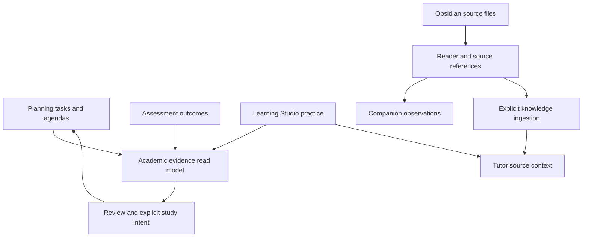

# ANVAYA — Planning, Analysis and Obsidian audit

**Audit finalized:** 12 November 2026 (Asia/Kolkata); source/runtime investigation performed 7–8 November; main rechecked unchanged on 12 November
**Repository:** [anandpriyadarsi/Personal--AI--Learning-Chatbot](https://github.com/anandpriyadarsi/Personal--AI--Learning-Chatbot)
**Inspected main:** [`abe8b3ee21689aede76eb8c325a7687e470812eb`](https://github.com/anandpriyadarsi/Personal--AI--Learning-Chatbot/tree/abe8b3ee21689aede76eb8c325a7687e470812eb)
**Scope:** local Flask web application; audit and design only. No implementation, PR, merge, personal-data migration, Android work or provider call. Synthetic fixtures below are test data, not Anand's academic records.

**Companion execution document:** `ANVAYA_PAO_Implementation_Blueprint_for_Work.md`.

## 1. Executive verdict

ANVAYA does not need three replacement dashboards. It needs a reliable **plan → study → review → revise** workflow over the owners already present in the repository.

- **Planning should become a daily action workspace:** capture a small task, link its subject and source, choose available time, record partial or completed work, and deliberately reschedule what remains.
- **Analysis should become a weekly evidence review:** explain what was planned, what was actually recorded, which assessment or practice evidence merits a recheck, and offer at most three traceable next actions.
- **Obsidian should remain an optional connected knowledge source:** a fast, faithful reader and link browser with durable identities, safe imports, separate companion annotations, and explicit source-aware handoffs. It should not promise bidirectional synchronization.

The existing implementation is materially stronger than a placeholder: operational planning, approval gates, WAL-safe analysis snapshots, assessment evidence, live folder browsing, ZIP snapshots, backlinks and companion records all exist. Preserve these. The highest priorities are execution-state consistency, source identity and command safety, followed by shorter, better-connected student workflows.

### Top ten issues and opportunities

| # | Priority | Finding | Evidence and consequence |
|---|---|---|---|
| 1 | P0 | Month-plan refresh can reopen completed tasks | Reproduced: agenda completion leaves `manual_revision=0`; changed import sets status back to backlog while keeping completed timestamp. |
| 2 | P0 | Obsidian annotations can attach to the wrong source | Reproduced: two vaults containing the same assistant UUID share companion entries through the V2 adapter; duplicate IDs within one vault are admitted by reader. |
| 3 | P0 | Desktop command and ingestion boundaries are inconsistent | Reproduced fake-service cross-origin legacy disable accepted; legacy Markdown discovery includes outside-vault file symlink. No cloud disclosure was tested or claimed. |
| 4 | P0 | Import overflow silently discards the tail | Reproduced 1,001-task source accepted as valid 1,000-task preview without warning. |
| 5 | P1 | Task completion and concurrent state changes need one transaction owner | Two preapproved agendas can complete one task twice; deterministic stale-read reproduction overwrites archived state. |
| 6 | P1 | Weekly totals disagree with execution semantics | Draft/unallocated effort counted; no-agenda week reports zero missed deadlines; closed review displays recalculated totals rather than its stored snapshot. |
| 7 | P1 | Capture and scheduling omit necessary student context | Task form lacks canonical course/topic pickers; arbitrary preferred-day text and top-five preselection can hide feasible work. |
| 8 | P1 | Analysis is a long composition with mixed scopes | Assessment filters do not constrain Learning Studio or Notes; row caps precede category filtering; main CTA loses insight/topic context. |
| 9 | P1 | Obsidian reader repeats whole-vault work and has fidelity gaps | Preview/backlinks run during activity validation; fenced wikilinks are rewritten; local image path support is not wired into this reader. |
| 10 | P1/P2 | Existing joins need to be surfaced, not reinvented | Academic evidence already supports explicit manual study intents and source-grounded help; build a consistent action path to those owners. |

P0 here means a data integrity/privacy issue that should block expanding the affected workflow; it does not assert that the user's current records are damaged. Detailed subsystem appendices retain their original local severity labels; the table above is the final cross-feature prioritization.

## 2. Verification and repository inventory

### Snapshot and PR status

GitHub connector metadata and a read-only checkout agree on the inspected current main. Source links in this report refer to that commit, not a moving branch. A later Work run must compare its current main against this snapshot before editing.

| PR | Verified status at audit | Relevance |
|---|---|---|
| [#21](https://github.com/anandpriyadarsi/Personal--AI--Learning-Chatbot/pull/21) | Merged | Planning/Analysis V2 evidence hub and proposals. |
| [#23](https://github.com/anandpriyadarsi/Personal--AI--Learning-Chatbot/pull/23), [#24](https://github.com/anandpriyadarsi/Personal--AI--Learning-Chatbot/pull/24), [#25](https://github.com/anandpriyadarsi/Personal--AI--Learning-Chatbot/pull/25) | Merged | Planner reliability, academic receipts, owner-published WAL snapshots, normal launcher wiring. |
| [#26](https://github.com/anandpriyadarsi/Personal--AI--Learning-Chatbot/pull/26) | Merged | Home/Obsidian UI V2. |
| [#31](https://github.com/anandpriyadarsi/Personal--AI--Learning-Chatbot/pull/31), [#33](https://github.com/anandpriyadarsi/Personal--AI--Learning-Chatbot/pull/33) | Merged | Source-qualified academic evidence and learning-loop integration. |
| [#55](https://github.com/anandpriyadarsi/Personal--AI--Learning-Chatbot/pull/55), [#57](https://github.com/anandpriyadarsi/Personal--AI--Learning-Chatbot/pull/57) | Open drafts | Historical Smart Notes/Obsidian and focus-reading branches; related behavior exists on inspected main. Do not merge these merely because they remain open. |
| [#61](https://github.com/anandpriyadarsi/Personal--AI--Learning-Chatbot/pull/61), [#68](https://github.com/anandpriyadarsi/Personal--AI--Learning-Chatbot/pull/68) | Open | Library and Learning Studio source branches; main has integration work from merged #69. Not proof of missing features. |
| [#69](https://github.com/anandpriyadarsi/Personal--AI--Learning-Chatbot/pull/69), [#70](https://github.com/anandpriyadarsi/Personal--AI--Learning-Chatbot/pull/70), [#71](https://github.com/anandpriyadarsi/Personal--AI--Learning-Chatbot/pull/71) | Merged | Web integration, browser evidence navigation and Library refinement. |
| [#72](https://github.com/anandpriyadarsi/Personal--AI--Learning-Chatbot/pull/72) | Merged; current main includes it | Unified Tutor + Coding Studio is present, opt-in, not merely proposed. Live provider quality/Colab execution are outside this audit. |

This is a relevant-PR inventory, not an ancestry proof that every line from every open branch was integrated. No branch-only PAO enhancement was verified as ready to adopt. Full branch diff reconciliation remains unnecessary for this read-only audit and should be scoped if Work discovers relevant deltas.

### Stack, configuration and authority

No JavaScript package-based application or SPA rewrite is needed. The active app is Python/Flask with server-rendered Jinja, scoped CSS and progressive JavaScript. `requirements.txt` pins Flask 3.1.2, Mistune 3.3.4 and PyYAML 6.0.3 alongside document/retrieval dependencies. `requirements-assessment-browser.txt` pins Playwright 1.51.0; `requirements-dev.txt` contains pytest and optional validation dependencies.

| Owner/surface | Exact paths | State, routes and flags |
|---|---|---|
| App factory and normal launcher | `personal_learning_assistant/ui/web/__init__.py`, `__main__.py`; root `phase7_web.py`, `config.py` | Factory registers feature blueprints. Normal launcher binds loopback, can explicitly activate Assessment extension and initialize Library, and starts trusted WAL publisher. We used fixture factories, not the personal-data launcher. |
| Planning home/tasks/day/week | `personal_learning_assistant/ui/web/routes.py:2457`; `templates/planning.html`, `planning_tasks.html`, `planning_day.html`, `planning_weekly_review.html` under same web directory | `/planning`, `/planning/tasks`, `/planning/day/<date>`, `/planning/review/week/<date>`. Backend service/repository authority, not localStorage. |
| Proposals | `personal_learning_assistant/ui/web/planning_proposals.py`; `planning_approval_controls.py` | `/planning/proposal/<date>`; signed preview/approval. Proposal context temporarily process-local. |
| Operational persistence | `personal_learning_assistant/repositories/sqlite/migrations/0006_operational_planner.sql`; task/day/month/week repositories | Canonical SQLite, nine operational tables. Task/import revisions and source references already partially exist. |
| Analysis composition | `personal_learning_assistant/ui/web/routes.py:993`; `services/academic_overview_service.py`; `learning_studio/analysis_view.py`; `services/anvaya_notes_service.py:862` under package | `/analysis`: academic overview plus separate Learning/Notes/legacy projections. GET should not mutate records. |
| Source-qualified evidence | `personal_learning_assistant/domain/academic_evidence.py`; `services/academic_evidence_service.py`; `ui/web/academic_evidence.py` | `/academic-evidence`, learning revision pages, explicit study-preview/study-intent. `ACADEMIC_EVIDENCE_ENABLED` defaults true. |
| Obsidian | `personal_learning_assistant/ui/web/routes.py:3897`; `ui/web/obsidian_connections.py`; `services/obsidian_workspace_service.py`; root `obsidian_integration.py` | `/obsidian`, `/obsidian/note?path=...`, `/library/connected-sources/obsidian`. One active folder or ZIP snapshot. No live two-way sync. |
| Obsidian history/companion | `personal_learning_assistant/services/obsidian_study_companion_service.py`; `repositories/sqlite/obsidian_study_repository.py`, `obsidian_study_repository_v2.py` | SQLite migrations 0005 and 0007; current schema chooses unified study interactions. Markdown remains external source. |
| Tutor/Coding | `personal_learning_assistant/ui/web/tutor_coding.py`; optional migration `0017_tutor_coding.sql` | `TUTOR_CODING_ENABLED` defaults false. Do not activate or alter it as a PAO migration side effect. |
| Optional schema | `personal_learning_assistant/repositories/sqlite/optional_migrations/` | Existing 0015 Assessment, 0016 Tutor memory, 0017 Coding; do not reuse these numbers. |

### Tests actually executed

1. **85 passed in 11.07 s:** `test_planning_analysis_v2.py`, `test_planning_v2_review_regressions.py`, `test_planning_v21_wal_snapshot.py`, `test_obsidian_connections.py`, `test_phase7_5_obsidian_workspace.py`, `test_phase7_5_obsidian_markdown_renderer.py` under `tests/`.
2. **73 passed in 1.09 s:** `tests/test_phase7_5_obsidian_study_companion.py` and `tests/test_phase5_obsidian_vault_registry.py`.
3. **32 passed in 50.40 s, real Chromium:** `tests/test_planning_analysis_v2_browser.py`. Populated and empty Assessment fixtures; Planning/Analysis widths 360, 390, 768, 1024, 1366, 1536, 1920. Filter persistence, keyboard focus, disclosures, no horizontal overflow, signed draft→approve→record actual time, weekly review save. The browser test intentionally disables JavaScript, proving server-rendered core controls; it does not certify every JS interaction.

These are **190 existing test cases**, not a full suite or new release certification. Additional disposable reproductions in the appendices demonstrate gaps despite those passes. Initial browser setup failed while Chromium was still downloading; the completed rerun produced the 32-pass result above. No application fix was made to obtain it.

Audit environment used Python 3.12, Flask 3.1.2 and Playwright 1.51.0. Some ancillary installed packages differed from repository pins (pytest 9.2.0, Mistune 3.4.0, Requests 2.34.2); therefore these results do not certify the exact pinned Windows environment. Renderer code-order defects below are source-backed and reproduced, but Work must repeat renderer tests with pinned Mistune. Real personal data, physical Galaxy M11 performance, Windows runtime, live AI, Google Calendar accounts, external Obsidian application launch and full-vault load were not tested.

The browser supplement below records additional JavaScript-enabled inspection. Screenshots used for inspection contain synthetic material; they are not pictures of the user's installation.

## 3. Analysis AS-IS, formulas and issues

### What is already trustworthy and should be retained

`academic_overview_service.py` uses an aware clock in Asia/Kolkata, validates 7/28/90-day filters, separates self-reported and evaluated sessions, retains each session's mark denominator, refuses to infer independence, and discloses truncation. Draft agenda effort is excluded in its `_effort` projection. Missing actual minutes remain `None`, distinct from explicit zero. Unknown evidence is not called failure.

Live WAL access is deliberately constrained: an academic owner publishes a committed in-memory snapshot; freshness defaults to 120 seconds. Without a valid feed, analysis fails safely instead of treating a stale immutable database image as live. Preserve this unusual but intentional physical read boundary.

Learning Studio's component uses recent module revisions, current wrong/recovered observations and direct lesson/question links. Correct retries do not become mastery. Notes counts describe personal Notes only; Obsidian companion counts are not silently combined. Legacy progress/risk claims are explicitly disclosed as unreviewed.

### Exact current metric behavior

| Metric | Current inputs/calculation | Scope/limitations |
|---|---|---|
| Evaluated/self-reported/pending sessions | `_assessments`, lines 172–241: terminal state, response count, evaluator class, grading timestamps and denominator checks | Latest bounded sample of 100 sessions, category filter applied after sample; not complete history count. Paper self-reviews use separate projection. |
| Session marks | Sum qualifying `awarded_marks_milli` /1000 against session maximum | Complete final coverage required; negative awarded marks supported; no average across unlike tests. |
| Open/overdue tasks | `_tasks`, lines 243–255: first 100 active tasks ordered priority/due/id; overdue if due date before local date | Current backlog, not selected historical window. Overdue number can omit low-priority tasks outside first 100. |
| Planned/actual effort | `_effort`, lines 257–275: sum task/study/manual agenda minutes on approved/active/closed days | Null actual time is unknown; current completed-state ratio describes agenda items, not distinct canonical tasks. Unlinked manual work excluded in course filter. |
| Topic observations | `_topics`, lines 277 onward: last 500 response rows, filtered to evaluated sessions; latest outcome per question ID | Question IDs deduplicated, semantic equivalents not. Mapping is unreviewed; only latest session linked, not complete provenance for all aggregated responses. |
| Learning practice | `learning_studio/analysis_view.py:10–72`: latest eight module/revision contexts; repeated miss priority | Independent source scope, no course/date args from hub; no cross-owner mastery calculation. |
| Notes | `services/anvaya_notes_service.py:862–920` | Collection counts and shares; no relation to success/retention. Notes course strings are not automatically equivalent to canonical topic mapping. |

### Additional Analysis findings

**A1 — P1, static: category filter can conceal older matching evidence.** `LIMIT+1` selects newest sessions before `evidence` filtering. With 100 newer pending sessions, an evaluated result still inside the chosen 28-day window is excluded; UI says “No matching assessment evidence.” Sampling is documented inside a disclosure, but the result and metrics are easy to interpret as complete. Filter the population first for matching results or show “No evaluated result in the latest 100 sessions” with pagination. Separate complete count queries from paginated rows where inexpensive; never silently promise complete totals.

**A2 — P1, static: mixed scope on one page.** Route `analysis()` passes filters only to `_academic_overview()`. `component(learning_service())`, Notes and legacy home projections use independent scopes. The disclosure admits this, but course/time controls appear global. Give every section an explicit scope label now; target a common read-context envelope where supported, and mark Notes as all-time inventory. Evidence category must apply to assessment section only.

**A3 — P1, static: insight-to-action context is dropped.** Hero link goes to bare `/planning`; topic observations go to one evaluation page. There is already a stronger explicit study-intent workflow in `ui/web/academic_evidence.py:145–177` and `OperationalTaskService.create_manual_study_task`. Reuse it and extend the source contract for task references, rather than creating a second task store or silently assigning urgency from an incorrect answer.

**A4 — P1, runtime plus static: weekly and hub effort are different metrics.** See Planning appendix. Hub excludes draft agendas; weekly aggregation includes them and ignores recording coverage. Define shared semantics, not merely matching labels. Completion counts must distinguish agenda attempts from canonical task completions.

**A5 — P2, static: page cost and information density.** `/analysis` composes academic overview, legacy home analysis, Notes analysis and Learning evidence even when a user wants a short weekly decision. Hidden legacy panels still incur backend work. Move collection statistics and legacy records to expandable/lazy sections or secondary views after correctness work. Avoid making eight module cards, note-type donut and historical progress compete with the next useful action.

**A6 — P2, static: narrow typography.** `planning_analysis.css` uses 0.68–0.73rem metadata in several areas. Existing overflow tests pass; that is not a readability or screen-reader certification. Raise essential labels to a readable size, keep only truly secondary timestamps small, and test 200% zoom with keyboard focus and long titles.

## 4. Cross-feature learning loop and ownership



The map shows existing conceptual joins; it does not imply every arrow is a single clickable UI action. In particular, opening/importing an Obsidian source is not proof its contents have been freshly indexed for Tutor.

| Student journey | Current verdict | Missing join / improvement |
|---|---|---|
| Capture an assignment and attach course/topic | Partial | Backend IDs exist; native task form omits them. Add a compact canonical picker and optional source reference. |
| Plan around classes/sports | Partial | Calendar recurrence/routines/import exist; explicit proposal has one window and hidden fixed caps. Use multiple availability windows and visible unscheduled reasons. |
| Start and partially finish a session | Partial | Approved items accept actual time and completion/skip; not a complete pause/partial execution experience. Add explicit manual work logs, not automatic time inferred from open tabs. |
| Miss a block and revise week | Partial | Daily close/rollover exists; improve source-state consistency, show residual work and preserve dates/history. |
| Assess, identify a gap, schedule revision | Substantive backend, fragmented UI | Assessment evidence/recovery and manual study intents exist. Surface reviewed contextual actions; never force every incorrect response into urgent work. |
| Read an Obsidian note and preserve a doubt | Present with identity defects | Fix duplicate/vault scope before expanding integrations. Source remains unchanged. |
| Use note as Tutor grounding | Separate ingestion path | Expose current/indexed version, explicit consent and revalidation. No connection-only claim of index freshness. |
| Export/calendar sync | Not found in inspected PAO paths | Calendar is internal academic planning. No Google OAuth/sync or ICS import/export implementation was found here. Optional ICS export is lower risk than account sync. |

**Single source of truth means one owner per fact, not one giant database.** Canonical academic SQLite owns course/topic IDs and task/assessment state; Learning Studio owns its revisioned lesson/practice store; native Notes own their content; external Markdown/original documents own their bytes; retrieval indexes are derived. Link by qualified IDs and versions. Do not move native Notes or Learning Studio into academic tables merely to make a dashboard query easy.

### Integrity and privacy register

- Preserve course IDs as IDs. Some existing interfaces use course codes/display strings; resolve through exact active catalogue, never fuzzy names. Validate topic belongs to course and assessment belongs to that course.
- Owner snapshots have timestamps; separate sources are not one atomic global snapshot. Label per-source freshness and avoid totals that imply otherwise.
- Task imports and execution commands currently disagree about revision ownership. Fix before adding automatic rollover/recurrent task creation.
- Source path is a locator, not stable identity. Hash is a version/integrity check, not sufficient identity for identical notes.
- Browser activity is a measured interaction proxy, not active thinking, study completion or mastery.
- Local folder paths refer to the Python host. A phone accessing a host cannot select an arbitrary phone folder by entering its path. ZIP is an explicit snapshot alternative. The default loopback server is not a LAN deployment design.
- Current read safety differs between Obsidian reader and legacy ingestion. Use one guarded adapter throughout. Do not claim verified cloud exposure from the discovered file-discovery weakness.
- Local web requires a running Python host for academic actions. Do not add a browser-side shadow write store or promise offline mutations without a replay/conflict design.

## 5. Prioritized recommendation matrix

Scores: impact/mobile benefit/data-safety benefit 1=low, 5=high; effort/risk 1=low, 5=high. Scores are architectural judgments, not measured costs. Effort is relative and includes migration/testing.

| ID | Recommendation | Priority | Impact | Effort | Risk | Data safety | Mobile | Depends on |
|---|---|---:|---:|---:|---:|---:|---:|---|
| R1 | Unify task commands, execution revisions, idempotent terminal completion and import reconciliation | P0 | 5 | 4 | 3 | 5 | 3 | Existing owner repositories |
| R2 | Guard every PAO mutation alias and unify vault filesystem boundaries | P0 | 5 | 2 | 2 | 5 | 3 | Route inventory |
| R3 | Reject over-limit imports before truncation | P0 | 4 | 1 | 1 | 5 | 3 | Import validator |
| R4 | Durable connection/note identity with explicit conflict repair | P0 | 5 | 4 | 4 | 5 | 4 | Safe reads, migration rehearsal |
| R5 | Shared weekly metric definitions, historical snapshot fidelity and evidence coverage | P1 | 5 | 3 | 2 | 4 | 5 | R1 |
| R6 | Today / This Week / Backlog / Exams navigation with compact quick capture | P1 | 5 | 3 | 2 | 3 | 5 | R1; existing date/calendar owners |
| R7 | Durable availability proposals and feasible-candidate scheduling explanations | P1 | 5 | 3 | 3 | 4 | 5 | R1 |
| R8 | Two–three evidence-backed weekly actions with source-linked task preview | P1 | 5 | 3 | 3 | 4 | 5 | R5, existing evidence intents |
| R9 | Versioned vault manifest, bounded single-note validation and shared link resolver | P1 | 4 | 4 | 3 | 4 | 5 | R4 |
| R10 | Reader fidelity, safe local attachments, provenance-rich copy/Markdown export | P1 | 4 | 3 | 3 | 5 | 5 | R2, R4, R9 |
| R11 | Simplify Analysis: move Notes donut/legacy panels out of primary decision view | P1 | 4 | 1 | 1 | 2 | 5 | R5; preserve access to records |
| R12 | Exam preparation queue and optional reusable plan templates; later ICS export | P2 | 4 | 3 | 2 | 3 | 4 | R6/R7, exact assessment dates |
| R13 | Full vault graph, new rich editor, automated bidirectional sync, AI productivity/mastery score | Reject now | 1 | 5 | 5 | 1 | 1 | No MVP justification |

Keep study streaks out of the primary review. If eventually shown, define them only from explicit qualifying logs, allow gaps without punishment, and never substitute them for learning evidence. Reminder delivery needs an explicit channel/background runtime; a deadline in a table is not a delivered notification. No additional reminder service belongs in this MVP.

### Major architecture choices

| Decision | Viable option A | Viable option B | Recommendation |
|---|---|---|---|
| App UI | Extend SSR/Jinja with small progressive interactions | New SPA and API layer over same services | A: current forms/test coverage work without JS; smaller mobile cost and regression surface. |
| Shared data | Federated read projections and qualified references | Consolidate Notes/Learning/academic storage | A: retain owners; consolidation would force unrelated migrations and blur evidence authority. |
| Task history | Keep aggregate rows plus append-only execution/command receipts | Full event-sourced planner rewrite | A: enough auditability with existing schema; event sourcing adds unnecessary reconstitution complexity. |
| Obsidian | Read-only connected source + explicit copy/export | Managed writeback limited to opted-in files | A for MVP; B later only with reviewed diff/hash/backup and clear external-editor conflict handling. Full sync is not equivalent to B. |
| Vault discovery | Explicit refresh + derived manifest and direct selected-file revalidation | Always-on filesystem watcher | A first: deterministic cross-platform behavior, no background watcher dependency. A watcher can later feed the same refresh owner. |
| Calendar | Explicit ICS export | OAuth and two-way Google Calendar sync | Export later if needed; sync introduces credentials, ownership and conflict semantics without fixing core planning. |

## 6. Target student experience and mobile wireframes

### Planning

At 390px: heading “Today”, date, one compact add-task control; four wrapping navigation options Today / This Week / Backlog / Exams. Show next approved action and available-window setup before statistics. Today's items stack vertically: time or “Not scheduled”, task title, subject, remaining estimate, source action, and Start/Log progress. No two-column mobile editor and no fixed bottom bar over content. Completed items collapse into history.

Quick capture requires only a title. Course/topic/source are optional but explicit; unlinked tasks show “No subject linked” and remain in All tasks. Expand Details for estimate/deadline/priority. Date-only deadlines must remain distinct from exact instants. After saving, retain filters and focus the new task. Validation keeps entered text.

This Week uses a compact date list with optional desktop grid; users can select multiple available windows around actual classes/sports. Moving work requires a deliberate action and preserves its earlier placement/outcome. Backlog separates “Needs timing review” from “Ready to schedule.” Exams derives dates from existing assessments; unknown date means “Date not entered”, not an invented countdown or readiness percentage.

### Analysis

First screen: week selector, course scope, small freshness label, three facts—approved plan, recorded actual with logging coverage, and completed/distinct work. Below: at most three suggested actions with “Why this?”, evidence count/date, Open evidence and Preview task. Suggestions are rules-based and dismissible. Unknown source blocks only the affected suggestion.

Assessment results retain each scale and evaluator qualification. Topic “Needs recheck” is preferable to “Weak” unless reviewed evidence supports a stronger statement. Practice retries, self-ratings and reading activity remain visibly different signals. All-time Notes inventory moves to a secondary disclosure. Accessible table/list alternatives accompany any later trend chart.

### Obsidian

Connection status with plain “Local folder — read only” or “ZIP snapshot — imported [time]”. Search, folder/path breadcrumbs, readable note list. On phone, note reading fills one column; backlinks and companion appear as secondary drawers or disclosures with focus restoration. Duplicate-ID or moved-file conflict shows an actionable explanation without silently reassigning notes.

Source actions: Open original / Open in Obsidian when meaningful / Link to task / Copy as independent Note / Export selected Markdown. Each transfer preview states what is copied and what is excluded. Snapshot refresh shows additions, changes, missing files and identity conflicts before applying. Existing copies remain independent.

### State/accessibility acceptance

- Empty: one useful next action; no invented score, deadline, task or course. Empty filtering differs from unavailable database.
- Missing/locked source: retain visible historical record and provide retry/reconnect; do not create replacement DB/index on GET.
- Stale submission: 409 plus preserved input and “Review latest changes”; never silent overwrite.
- Offline/server unavailable: no false save toast; retain unsent text locally only as an explicitly labeled draft if implemented, never academic authority.
- Keyboard: real labels, native controls, tab order, visible focus, Escape/return focus for drawers, no hover-only commands, status announcements and non-color outcome labels.
- Mobile: test 320/360/390px, long titles/paths, 200% zoom, soft keyboard height, touch targets at least 44px for primary controls; no horizontal page scroll. Do not certify phone performance from desktop viewport emulation.

## 7. Fact, assumption and unknown register

| Type | Statement | Handling |
|---|---|---|
| Fact | Main contains real operational planner, evidence projections, folder/snapshot Obsidian and merged Coding Studio | Reuse source and owners; do not rebuild from old PR descriptions. |
| Fact | Defects reproduced in disposable fixtures, not user data | Block unsafe expansions; investigate actual affected rows only during explicit local repair workflow. |
| Fact | No substantive repository edit or GitHub mutation performed | Checkout-only line-ending normalization appears for two old root files; whitespace-insensitive diff is empty. No logical source change. |
| Assumption | Primary value is a small daily/weekly routine rather than automated scheduling | Recommended design, not a previously approved user choice. |
| Assumption | External Obsidian remains authoritative; native Notes stay independent | Safest MVP default, consistent with present UI. |
| Unknown | Size/state of user's current vault, DB, runtime flags and existing ambiguous IDs | Work must inventory locally and show migration dry run; never fabricate a backfill. |
| Unknown | Actual phone/network/Windows performance | Measure on supported Windows and representative phone after implementation. |
| Unknown | Live provider behavior and external calendar account needs | Out of PAO MVP; no provider or OAuth dependency. |
| User choice later | Optional writeback, reminder channel, custom weekly capacity, recurring templates | Not needed to implement safety foundation. Defaults: no writeback, no reminders, user-entered capacity. |

## 8. First engineering changes and handoff

1. **Protect state and commands:** fix import truncation/reconciliation, transactionally guarded task changes, and all PAO mutation/file-read boundaries. Add the exact failing regressions documented here first.
2. **Stabilize identity and evidence:** scoped durable Obsidian IDs with conservative migration; one weekly metric contract and faithful closed-review snapshots.
3. **Connect the daily workflow:** quick capture with canonical links, durable availability, and evidence→reviewed task→study source actions in a compact mobile interface.

Execute **`ANVAYA_PAO_Implementation_Blueprint_for_Work.md`**, using this report as the source rationale. The audit itself authorizes no implementation or merge.

## Reference notes

Repository source is the primary evidence; appendices give paths and line anchors. External documentation was checked only for integration/security boundaries: [Flask security](https://flask.palletsprojects.com/en/stable/web-security/) recommends explicit CSRF/host controls; [Obsidian internal links](https://obsidian.md/help/links) describes Markdown/wiki/heading link formats; [Obsidian URI](https://obsidian.md/help/uri) describes opening a note in a locally available vault. These references do not certify ANVAYA's implementation or imply sync support.


# Appendix A — Detailed Planning evidence


Scope: read-only source inspection of Planning routes, services, repositories, schema, templates and tests. No repository files or personal data were changed. Two short Python programs used `TemporaryDirectory(prefix='planning-audit-')`, fresh SQLite migrations and synthetic records only. Runtime: `/workspace/scratch/f85dcab0a2ec/audit-env/bin/python`, `PYTHONDONTWRITEBYTECODE=1`; executed from repository root. All fixture databases were removed automatically. Existing test-suite results belong to parent audit; I did not run pytest. Statements below marked **observed** were reproduced on those isolated fixtures; **static** means direct source reasoning, not a browser observation.

All source paths below are relative to `personal_learning_assistant/` unless prefixed `tests/`.

## As-is capability and authority map

| Surface | Entry points | Behavior and authoritative state |
|---|---|---|
| Planning home | `ui/web/routes.py:2457`, `templates/planning.html` | Calendar day/week/month, open/overdue task summary, task course filter, today's agenda link, weekly review/month import links, evidence source limits; legacy learner-reported progress and saved plans remain inside disclosure. Composes academic overview + operational planner + legacy dashboard. |
| Tasks | GET/POST `/planning/tasks`; POST `/planning/tasks/<id>` and `/status` (`routes.py:2487–2601`) | Create/edit title, description, priority, effort, due date, free-text preferred day/window, rollover policy. Complete/archive controls. GET accepts status/priority/course filters, but template exposes no filter controls. Create route does not accept course/topic/assessment identity although service supports it. `planner_tasks` is authority; manual transitions increment manual_revision. |
| Month-plan import | GET `/planning/month-plan`; POST `/preview`, `/approve` (`routes.py:2604–2680`) | YAML safe-load, max 2 MB, schema marker, normalized tasks/events/routines/assessment candidates, preview then source-SHA approval, deterministic IDs, import ledger and atomic bundle application. Exact hash reimport is no-op. Unknown official exam slots stay unknown. Changed import rejects manual_revision changes on task/routine rows. |
| Calendar | `/calendar`, Planning timeline | `OperationalCalendarService` and SQLite repository merge academic events, expanded recurrence, routines, task due markers, assessment scheduling. Task due dates are explicitly not study slots. `operational_calendar_repository.py:52`, `:87`, `:100`, `:119`, `:136` enumerate reads. |
| Daily agenda | `/planning/day/<date>` GET, `/generate`, `/approve`, `/items/<id>`, `/close` POST (`routes.py:2682–2797`) | Preview/generate draft, approve, record actual minutes/complete/skip, daily reflection, choose at most two carry tasks, prepare next-day draft. Agenda ownership: `daily_agendas`/`daily_agenda_items`; rollover decisions: `task_rollover_events`; reflection: `daily_reviews`. |
| Explicit availability | `/planning/proposal/<date>` GET/POST (`ui/web/planning_proposals.py:37`) | One from/until window; signed 15-minute preview token with semantic hash and whole-planner fingerprint; save draft then explicit signed approval. Same-origin checks. Timezone + break policy bound to preview. Context is process-local memory. |
| Scheduler | `services/daily_agenda_service.py:197` | No invented availability; hard 06:00–22:10 bounds; subtract fixed commitments and buffers; unknown occupancy blocks scheduling; reject past days/elapsed slots; DST transition day fails closed. Select max five flexible tasks; deep-work count three or one if ≥4 timed fixed items; P0 first, then due/created/id; selected study items and tasks share capacity. Overdue tasks stay visible but require due-date revision to place. |
| Completion cross-links | `repositories/sqlite/daily_agenda_repository.py:195` | Completing a task updates planner_tasks. Completing a canonical study_plan_item validates date/status, changes canonical status atomically, and creates a uniquely named self-reported study_session only when actual minutes >0. No assessed mastery or official grade is fabricated. |
| Weekly review | `/planning/review/week/<date>` GET/POST (`routes.py:2800–2845`) | Monday–Sunday aggregation, completed/planned counts, actual/planned focus minutes, carry count, missed deadlines; save/close reflections and three free-text priorities. `weekly_reviews` snapshots metrics on save; closed row cannot be edited. Priorities do not become tasks. |
| Legacy plan reads | `services/planning_dashboard_service.py:261`, SQLite study-plan repository | Saved weekly/multi-course/intelligent plans rendered as historical learner-reported records. SQLite study-plan adapter intentionally rejects writes (`repositories/sqlite/study_plan_repository.py:465–485`). This is a separate read model from operational task/agenda workflow. |

Schema: migration `repositories/sqlite/migrations/0006_operational_planner.sql` creates nine operational tables: month_plan_imports, month_plan_import_items, planner_tasks, routine_templates, daily_agendas, daily_agenda_items, task_rollover_events, daily_reviews, weekly_reviews. Existing courses/topics/assessments/academic_events/study_plan_items/study_sessions remain cross-module authorities. Daily agenda `source_type/source_id` is a polymorphic reference, not a foreign key; task course/topic/assessment fields have individual FKs but not a composite course-topic consistency constraint. Import provenance has source hash and snapshot-hash columns, but service populates entity_snapshot_hash as empty (`month_plan_import_service.py:570`).

## Prioritized findings (8)

### P1-1: A revised month import reopens work completed through the agenda — observed

Evidence: `repositories/sqlite/daily_agenda_repository.py:240–244` sets planner task completed/status/timestamps without incrementing manual_revision. `repositories/sqlite/month_plan_import_repository.py:216–229` only protects source-managed tasks/routines whose manual_revision >0. Its task UPSERT at `:340–356` overwrites status from imported payload while retaining existing completed_at. `services/month_plan_import_service.py:570` writes an empty entity snapshot hash, so there is no alternate snapshot reconciliation here.

Reproduction: import a one-task plan; generate and approve a day; complete that task via daily service; change only plan_metadata.title and approve new file hash. Before reimport task is `('completed', 0, '<timestamp>')`; afterward it is `('backlog', 0, '<same timestamp>')`.

Impact: completed work silently returns to inbox/scheduler and history becomes internally contradictory. Completing from task inbox does increment manual_revision; identical intent receives different protection depending on UI path.

Fix direction: route all execution state transitions through one canonical transaction; preserve completed/archived execution state during source refresh; increment a shared revision on every owner mutation. Import preview must show field-level reconciliation and distinguish source-owned schedule/title fields from user-owned execution fields. Do not merely forbid every import forever after one completion.

### P1-2: One task can be completed twice through separate agendas, or completed after archival — observed/static

Evidence: `daily_agenda_repository.py:215` prevents duplicate completion only for the *same agenda item*. Study sources get canonical checks at `:218–226`; planner tasks instead get an unchecked UPDATE at `:240–244`, whose condition excludes archived rows but whose rowcount is ignored. Generation takes all open tasks, without reserving them against other approved days (`services/daily_agenda_service.py:177–179`, `:213–221`).

Observed: generate/approve two days containing the same task before executing either. Complete both agenda items for 30 minutes each. Both succeed; query returns two completed receipts and 60 actual minutes for one task. Static archived variant: archive canonical task between approval and execution; agenda item still commits completed even though UPDATE affects zero task rows.

Impact: completion counts and effort can overstate actual execution; archived canonical state and agenda receipt disagree. Independent repeated work should have explicit distinct occurrences/sessions, not accidentally repeat a terminal task.

Fix direction: transactionally check canonical state/revision and record idempotent completion receipt. Decide product semantics for one task split across days: multiple execution sessions are legitimate but terminal completion must be singular. Keep the source-aware behavior already used for study items.

### P1-3: Task state machine and archived edit rule are vulnerable to stale writes — observed deterministic race

Evidence: `services/operational_task_service.py:239–260` reads status then validates before calling repository; edit does same at `:266–295`. Repository transaction only does `UPDATE ... WHERE id=?` (`repositories/sqlite/planner_task_repository.py:177–190`); no expected revision/status predicate. The transaction protects the individual write, not read–validate–write invariant.

Reproduction: substitute a get_task wrapper that returns the old backlog row but commits an archive through the same repository immediately before returning. Calling transition(completed) accepts old backlog->completed legality and overwrites archived state. Observed final status `completed` with nonnull archived_at. This is a deterministic simulation of two concurrent requests, not a load test.

Impact: competing tabs/actions can reverse terminal states or edit records that were archived after validation. Source refresh and agenda completion also touch this state.

Fix direction: expected_revision compare-and-swap checked with transition legality under BEGIN IMMEDIATE; return typed conflict 409 and retain submitted edit. Add canonical command idempotency for replayable execution actions.

### P1-4: Weekly evidence conflates drafts, allocated effort, historical outcomes and live state — observed

Evidence: `repositories/sqlite/weekly_review_repository.py:118–132` returns all-zero metrics when no agenda IDs, so it never evaluates task deadlines. At `:135–141` it counts every agenda item and sums all planned_minutes, including unscheduled tasks and drafts; there is no agenda-status or slot predicate. At `:149–155`, missed deadlines use current task status and SQLite date('now'), rather than historical completed_at and configured local clock. `services/weekly_review_service.py:52–64` always recomputes evidence even when review is closed; template `ui/web/templates/planning_weekly_review.html:9–12` displays that live evidence rather than saved closed metrics.

Observed: (a) one overdue task and no agendas yields missed_deadline_count=0; (b) five unscheduled 30-minute draft tasks yield planned_focus_minutes=150, while day summary correctly reports scheduled_focus_minutes=0; (c) close week with stored planned_focus_minutes=150, then generate another draft in that week: closed review UI model reports 300 while stored review stays 150.

Impact: weekly review can suggest no missed work, imply allocated capacity that never existed, or change retrospectively after being closed. Missing actual effort is rendered as 0 rather than separated from known zero.

Fix direction: shared metric specification with separate proposed/approved/scheduled/executed measures, denominator coverage and an injected as_of/timezone. Compute task outcomes independently of agenda existence. Closed review should show immutable as-of evidence and separately label a live comparison if desired. Define missed deadline by completion time relative to deadline and preserve provenance.

### P2-5: A 1,001-task import is silently accepted as a 1,000-task import — observed

Evidence: `services/month_plan_import_service.py:389` truncates task_sources before validation using `[:MAX_ITEMS]`; overflow validation at `:427` checks len(seen), which has never seen the tail. Similar slices exist for assessments/events/routine entries at `:259`, `:294`, `:331`.

Reproduction: minimal valid plan with only 1,001 uniquely identified flexible tasks under 2 MB. Preview output: `valid=True`, tasks=1000, errors=(), warnings=(). The last task is never reviewed and will not be imported.

Impact: silent loss of user work despite successful validation. Lower frequency than execution-state defects but cheap to fix.

Fix direction: validate collection types and total raw cardinality before normalization; reject over-limit sources with explicit count and limit. Apply same rule consistently across categories, including malformed nested shapes. Boundary tests at 999/1000/1001 and mixed-category overflow.

### P2-6: Unschedulable top-five tasks can starve feasible work despite explicit free time — observed

Evidence: `services/daily_agenda_service.py:220–221` slices to MAX_FLEXIBLE before duration/deadline/capacity eligibility. At `:315–319`, overdue candidates are then forbidden placement. All lower-ranked candidates are absent, with no queue explanation. Preferred day is accepted as arbitrary text (`services/operational_task_service.py:164`, `:290–292`) but `_preferred_day_allows` accepts only date or exact full weekday (`daily_agenda_service.py:125–135`); e.g. "Mon" or "tomorrow" silently excludes a task from every day.

Observed starvation: five overdue P0 30-minute tasks plus one feasible undated P1 30-minute task; explicit four-hour future availability. Preview selects five overdue tasks, all starts_at=None, and never presents feasible task. It does not explain why the sixth task is omitted. Preferred-day behavior is static.

Impact: user sees ample availability but cannot fill it with existing feasible work without individually changing higher-ranked tasks. Natural free-text preferences can make work disappear from agenda selection.

Fix direction: distinguish review-needed candidates from feasible candidates and show both; let user deliberately defer overdue blockers or schedule the next feasible work. Preserve explicit deadline-revision policy, do not silently shift overdue tasks. Replace free-text day/window with validated controls or parse with explicit feedback. Make caps/policy visible rather than invisibly skipping work.

### P2-7: Saved proposal availability cannot survive restart; unrelated activity invalidates all drafts — static/design limitation

Evidence: `ui/web/planning_proposals.py:21–26`, `:33–34`, `:60–65` store context in a process-local dictionary capped at 128 dates; signer uses random startup bytes (`:30`). `routes.py:2688–2700` suppresses approval when scheduled draft has no remembered context. This is intentionally fail-closed and communicated in template, not a security flaw. Fingerprint scans all rows in nine tables up to 10,000 rows each (`repositories/sqlite/daily_agenda_repository.py:87–98`), including unrelated agendas/reviews; `operational_planner_web_service.py:246–252` requires saved fingerprint still globally matches.

Reasoning: restart between Save draft and Approve requires fresh preview/save. In a multi-process deployment requests can hit different context maps. Recording work on another day or writing an unrelated daily review changes the global fingerprint and blocks this approval. At 10,001 historical agenda items the same guard blocks day review/proposal routes rather than only a large preview query. Not reproduced as production deployment issue.

Fix direction: persist explicit availability and policy version alongside each draft, with revision/idempotency context; source fingerprint should bind relevant candidate/commitment set under a consistent snapshot. Use per-aggregate versions to avoid scanning lifetime history. Keep current fail-closed behavior until the durable contract exists.

### P2-8: Task course context and lifecycle controls do not complete the visible workflow — static UX/functional gap

Evidence: home offers course filter (`ui/web/templates/planning.html:17–21`), but native create task POST at `routes.py:2526–2535` forwards no course_id/topic_id/assessment_id; task template new/edit forms (`planning_tasks.html:21–34`, `:81–98`) have no identity picker. Service create supports these IDs but update does not. GET task filters exist at `routes.py:2492–2496` with no filter UI. Template always labels list "Open tasks" and shows "Open" count even when explicit query requests completed/archived. Completion controls appear for skipped tasks (`planning_tasks.html:65`) although skipped->completed is forbidden (`services/operational_task_service.py:25`). No visible restore/reopen control; weekly priorities remain text only (`weekly_review_service.py:69–72`).

Impact: a task created from Planning cannot be attached to a course through that same workflow and vanishes from course-filtered home views; users cannot consistently reconcile completed/skipped/archived history or act on next-week priorities. This is an end-to-end product gap, not a missing database table.

Fix direction: add exact course/topic selection and safe reclassification, task views by active/completed/archived with valid transition actions, task-specific deep links, retained filters and form contents on error. Convert a review priority to a task only through explicit review and idempotent command.

## Incremental target architecture (Work blueprint input)

Retain the working Flask/service/repository shape and existing authoritative entities. Do not fork planner tasks or merge learner evidence into task status. Refactor boundaries incrementally:

1. **Task command authority.** One task lifecycle transaction handles inbox, agenda, import reconciliation and recovery/manual-study entrypoints. Add revision, typed conflicts and unique command/completion receipts. Task execution state is user-owned; source imports carry proposed changes. Keep study_plan_item completion owner-specific.
2. **Proposal aggregate.** Store proposal/draft ID, availability windows (allow multiple), timezone, break/cap policy version, selected candidates, source versions and explanation codes. Preview stays read-only; Save creates durable draft; Approve consumes current reviewed revision. Existing signed tokens bind immutable draft revision and intent. Restart need not erase valid availability.
3. **Scheduler as a pure function.** Inputs: normalized commitments with known/unknown occupancy, validated task/study candidates, explicit availability, as_of clock and visible policy. Outputs: placements + explicit excluded/review-needed/unscheduled reasons. No repositories or writes inside selection. Keep priority/overdue decisions transparent and cross-day reservations separate from terminal completion.
4. **Execution receipts.** A task can have multiple effort sessions if product semantics allow, but only one terminal completion per revision. Receipts link exact task/study item and agenda, identify self-report vs measured timer vs assessed evidence. Atomic source + receipt updates, replay-safe commands.
5. **Evidence projection.** Share definitions of allocated minutes, completed occurrences, actual-effort coverage, deadline outcomes and backlog with Analysis. Never equate task done with mastery. A closed weekly review records the immutable evidence snapshot/revision; live recalculations are a separate view.
6. **Import reconciliation.** Typed external schema + cardinality preflight + exact diff; stable external IDs; retain import version provenance; detect removed rows, source changes and user edits. Preview must show preserve/replace/conflict outcomes before approval. Do not use title-match as sole identity for ambiguous assessments.
7. **Work UI shell.** Inbox → choose work/availability → review proposal → approve → execute/record → reflect/reconcile. Link back to source course, study item and evidence without broad irrelevant filters. Keep legacy saved plans discoverable but clearly separate from approved operational work.

Recommended dependency order: correctness of canonical lifecycle and metrics first; then durable proposals; then scheduler choices and workflow UI; only then automation or intelligent recommendations.

## Concrete work packages and acceptance tests

| Package | Scope | Acceptance tests |
|---|---|---|
| W1 Canonical lifecycle integrity (P1) | Task revision/CAS; shared lifecycle operation; idempotent completion receipt; import preservation | Complete agenda then change import: completed remains; inbox vs agenda equivalent; complete same source in two agendas: one terminal receipt; archive after approval blocks completion; two simultaneous state changes yield one accepted + one 409; partial source/receipt failure rolls back. |
| W2 Weekly truth/coverage (P1) | Metric definitions and as-of clock; independent deadline query; immutable closed review snapshot | No agendas but overdue tasks; draft vs approved/scheduled counts; missing effort vs zero; late completion retained as missed deadline; close then later edits leave shown snapshot stable; timezone midnight; duplicate source occurrences cannot inflate completed task metric. |
| W3 Safe import boundary (P2) | Input typing/cardinality before loops; field ownership diff; removed-item policy | 999/1000/1001; mixed overflow; malformed nested objects/lists; dry-run DB byte invariance; changed imports preserve manual/execution state; concurrent preview/apply conflict; no-op source hash; explicit deletion review. |
| W4 Durable reviewed proposals (P2) | Migration for draft availability/policy/revision; relevant source version guards | Save/restart/reopen/approve without losing context; two processes; same-date concurrent saves; unrelated review does not conflict; relevant commitment change does; >10,000 historical items do not block current agenda; expired/tampered intent rejected. |
| W5 Scheduler explainability (P2) | Pure scheduler DTOs; valid preference fields; separate review-needed/feasible queue; visible cap choices | Five overdue plus feasible sixth; unknown duration; multiple free windows; conflicts and all-day unknown occupancy; DST; elapsed window; cross-day selected source; deterministic output and reason for each excluded candidate. Preserve existing no-invented-availability and shared task/study capacity tests. |
| W6 Complete Work flow (P2) | Course/topic task context; valid actions; historical filters; editable error feedback; explicit priority-to-task conversion | Create/link/edit course topic with valid ownership; link survives filtering; skipped task actions valid; completed/archived labels/counts correct; submitted values retained on validation failure; weekly priority creation idempotent and explicit; keyboard/mobile walkthrough. |

Existing tests inspected: `tests/test_phase7_5_operational_planner_routes.py`, `test_phase7_5_daily_agenda.py`, `test_phase7_5_weekly_review.py`, `test_phase7_5_month_plan_import.py`, `test_planning_v2_scheduler.py`, `test_planning_v2_proposals.py`, `test_planning_v2_review_regressions.py`, `test_architecture_planning_context.py`. There is valuable coverage for read-only GETs, PRG writes, import atomicity/idempotence, bounded rollover, study completion provenance, signed approval, stale previews, capacity, recurrence, clock/timezone/DST and restart fail-closed behavior. Missing scenarios above are behaviorally distinct; do not add tests that simply mirror implementation.

## Reproduction output preserved

Program 1: minimal one-task imported plan on fresh migrated temp DB; week with no agendas; generate/approve two unscheduled daily agendas, complete both; revise metadata title and reimport; preview 1,001-task source.

```
NO_AGENDAS_WEEKLY: {'planned_items': 0, 'completed_items': 0, 'planned_focus_minutes': 0, 'actual_focus_minutes': 0, 'carry_forward_count': 0, 'missed_deadline_count': 0}
TWO_COMPLETIONS: (2, 60)
PRE_REIMPORT: [('completed', 0, '2026-11-07T17:50:02Z')]
POST_REIMPORT: [('backlog', 0, '2026-11-07T17:50:02Z')]
1001_INPUT_TASKS: {'valid': True, 'count': 1000, 'errors': (), 'warnings': ()}
```

Program 2: fresh temp DB; deterministic interleaving wrapper on repository get_task; five overdue P0 tasks + feasible P1 with four-hour explicit window; close weekly review then add another draft.

```
ARCHIVE_RACE_FINAL: completed 2026-11-07T00:00:00Z
CANDIDATE_STARVATION: [('Overdue 4', None), ('Overdue 0', None), ('Overdue 1', None), ('Overdue 2', None), ('Overdue 3', None)]
UNSCHEDULED_DRAFT_WEEKLY: {'planned_items': 5, 'completed_items': 0, 'planned_focus_minutes': 150, 'actual_focus_minutes': 0, 'carry_forward_count': 0, 'missed_deadline_count': 0}
CLOSED_WEEK_PLANNED: {'stored': 150, 'displayed': 300}
```


# Appendix B — Detailed Obsidian evidence


Scope: read-only code inspection plus disposable fixture reproductions, no repository changes or real vault/config/database writes. In this appendix, services/, repositories/, domain/ and ui/ paths are relative to personal_learning_assistant/; tests/ and root Python filenames are repository-relative. The primary audit performed UI and additional existing tests. This document is intermediate audit evidence, not an implementation.

## Actual supported architecture

- **One active connected source**, stored in `obsidian_config.json`, with local-folder and imported-snapshot modes. `obsidian_integration.py:91-106` changes folder configuration; `:55-59` relocates snapshot path after restore. Connecting is not a registry scan or a retrieval-index build.
- **Local vault reader/search** is real and independent of registry: `services/obsidian_workspace_service.py:173-237` scans current Markdown for browse/search; `:370-437` reads a note, resolves wikilinks/backlinks, supplies source hash and identity. Full paths need `.obsidian` (`obsidian_integration.py:72-88`). Browse/search are bounded in returned rows, not in scan cost.
- **Mobile-capable snapshot import** is real: `services/obsidian_connection_service.py:64-144` validates ZIP, copies only UTF-8 Markdown into fresh app-owned snapshot, creates inert `.obsidian/app.json`, then atomically changes configuration. Limits: 25MB compressed, 100MB expanded, 2,000 entries, 500KB per note (`:19-23`); path traversal, links, encrypted entries, duplicate casefolded paths, and missing/multiple vault markers rejected (`:35-42,74-94`). Non-Markdown attachments and configuration are explicitly omitted (`:102-105`). UI explains no live sync and omitted attachments (`ui/web/templates/obsidian.html:44-45`). Android refuses desktop-path connect (`ui/web/obsidian_connections.py:66-72`).
- **Independent copy into ANVAYA Notes** exists: batch 1–20 note paths, source read first, titles/body only passed to native Notes (`services/obsidian_connection_service.py:156-172`). `services/anvaya_notes_service.py:691-702` validates then atomically saves batch; `_base_record` creates new UUID (`:623-629`). This is a new native note, not an editable alias, backlink, or synchronized note. Repeated import intentionally creates further copies. No source provenance/identity/hash supplied in this payload.
- **Study companion** exists with key points/doubts/archive, reading sessions, replay-safe bounded activity, and source-hash validation (`services/obsidian_study_companion_service.py:167-193,221-405`). Reader GET itself is read-only; browser JS starts/heartbeats via explicit POST. Activity only accrues visible/focused/recent activity (`ui/web/static/js/obsidian_reader.js:4-7,50-55`), heartbeat every 30 seconds (`:232-233`). Stored in SQLite, not vault Markdown. New unified schema selected if available (`services/obsidian_study_companion_service.py:478-489`), otherwise old Obsidian schema.
- **Registry/link graph backend exists**, separate from reader: `phase5_scan_obsidian_vault.py:140-156` uses scanner + existing DB, preview by default / explicit apply. `services/obsidian_vault_registry_service.py:68-110` UUID5 logical vault/note identities; preserves explicit `assistant_id` on moves; `:337-348` refuses blocking scans. Supports relative Markdown links, heading/block/alias metadata, ambiguous links, tags, missing-file reporting (tests `tests/test_phase5_obsidian_vault_registry.py:82-274`). Not correct to say there is no graph or no rename-aware backend because reader UI lacks it.
- **Write backend also exists, but production Notes split retires its routes.** `services/notes_studio_editor_service.py:194-256` validates configured/registered vault and constructs `AtomicMarkdownNoteStore`; `repositories/filesystem/markdown_note_store.py` implements managed writes. `ui/web/routes.py:629-631` requires explicit compatibility factory injection; create/update/upload production endpoints return 410 (`:3455-3457,3512-3514,3550-3552`), read alias redirects to Obsidian (`:3709-3716`). Do not revive that legacy writer casually; inspect its journal/managed-ownership semantics before reuse.
- **Library join** is real: connected-source link (`ui/web/templates/library.html:96`) and unified search includes live vault results with study history (`services/unified_search_service.py:157-194`), separate from registered document/resource browsing. **Retrieval/Tutor join** exists through legacy knowledge source discovery: `knowledge.py:124`, `repositories/filesystem/knowledge_repository.py:102-128`, `services/knowledge_service.py:44-65`. It lists vault Markdown for knowledge ingestion; live browser search and indexed Tutor evidence are distinct paths. No basis to claim snapshot import automatically rebuilds retrieval or produces fresh Tutor citations.
- Deep link `obsidian://open?vault=...&file=...` is generated (`services/obsidian_study_companion_service.py:458-464`), hidden for snapshots (`ui/web/templates/obsidian_note.html:28-32`). It requires Obsidian and a matching local vault; not a sync transport.

## Priority findings

### P1: companion identity isolation fails for copied/duplicate assistant IDs (runtime reproduced)

`services/obsidian_study_companion_service.py:124-135` uses bare `assistant:<UUID>` without vault scope when valid frontmatter exists. Path fallback includes vault. `repositories/sqlite/obsidian_study_repository_v2.py:115-120,195-199,205-217,225-234` explicitly discards `vault_identity`, so same UUID in two different vaults joins key points, doubts, sessions, and archive scope. `services/study_item_resolver.py:23-42` duplicates this policy. Migration `repositories/sqlite/migrations/0007_unified_study_interactions.sql:67-96` also backfills only `note_identity`, drops vault/path locators to `{}`, so fixing runtime alone is insufficient.

Disposable migrated DB + vault1/A.md and vault2/A.md with same assistant UUID: add key point to vault1; vault2 reader returns it despite different vault identity hashes. This is realistic with copied vaults/templates/snapshots. Not multi-user exfiltration claim; it is wrong source attribution and cross-vault state mutation in one app.

Within a single vault scanner detects duplicate UUID as blocking (`repositories/filesystem/obsidian_vault_scanner.py:565-576`) but retains both notes; reader never gates on blocking identity issues (`services/obsidian_workspace_service.py:385-403`). Repro: workspace reports blocking=1; A.md and B.md both open with same assistant ID. Registry apply is stricter; reader must match.

Fix package: canonical `(connection_id, note_id)` identity; detect duplicate UUID and disable annotation mutation until resolved, keep source readable with clear conflict; migration retaining old records and explicit reconciliation when ambiguous. Acceptance: duplicated IDs in one vault cannot share writes; two vaults same UUID remain isolated; existing historical rows reconcile without silent merge; search/reader/Tutor links agree.

### P1: old desktop connection mutation routes bypass newer CSRF boundary (runtime reproduced)

New routes have CSRF decorator (`ui/web/obsidian_connections.py:33-48`), but `/obsidian/connect`, `/obsidian/enable`, `/obsidian/disable` invoke configuration writers directly (`ui/web/routes.py:4112-4162`). Global request-origin protection exits outside PRIVATE_MOBILE_MODE (`ui/web/mobile.py:54-71`). Safe fake-service Flask repro POST `/obsidian/disable`, Origin https://untrusted.example + Sec-Fetch-Site cross-site, no token: **303 and fake disable invoked**. No real configuration touched. Android has additional origin boundary; avoid claiming universal bypass there.

Fix package: retire old POST aliases or forward through identical command guard, cover companion form mutations too. Acceptance: each mutation alias rejects absent/bad token and cross-origin before factory/action; valid same-origin action works. Localhost-only binding is not CSRF protection.

### P1/P2: legacy knowledge discovery has weaker filesystem safety than vault reader (runtime discovery reproduced)

Safe reader refuses symlinks at root/each component (`repositories/filesystem/obsidian_workspace_reader.py:82-96,133-153`); scanner skips linked children (`repositories/filesystem/obsidian_vault_scanner.py:456-477`). Legacy `obsidian_integration.py:147-170` appends `.md` paths without file symlink checks. `repositories/filesystem/knowledge_repository.py:110-128` consumes these paths; `knowledge.py:183-199` opens them normally. Synthetic fixture outside.md + vault/link.md symlink: provider returns link.md. Therefore ingestion using that provider can read outside vault through a file link, despite safe reader refusing it. Repro verified discovery; not actual cloud/model exfiltration.

Fix package: all ingestion/read paths use one safe source adapter; allowlist root, no-follow file handle, bounded reads, expected hash. Scanner itself resolves root before checking symlink (`obsidian_vault_scanner.py:434,443`), so direct CLI scanner's root rejection is weaker than reader wrapper. TOCTOU remains a static hardening concern: path checks then `read_bytes` do not lock filesystem identity; no race exploit was run.

### P2: identity continuity breaks on ordinary rename, snapshot refresh, root restore (static consequence)

Vault identity hashes absolute root (`services/obsidian_workspace_service.py:111-120`); notes without assistant UUID hash vault+path (`services/obsidian_study_companion_service.py:130-134`). Snapshot import creates fresh random root each time (`services/obsidian_connection_service.py:125-139`), restore relocates runtime root (`obsidian_integration.py:55-59`). Thus reuploading same snapshot, moving vault root, or renaming normal Markdown makes a new study identity; old annotations/history remain but are inaccessible from new identity. Explicit assistant UUID survives rename in registry, but path-only ordinary notes do not. No auto-rename inference or confirmed mapping exists in reader. Existing snapshot restoration test checks accessible files, not study continuity (`tests/test_obsidian_connections.py:173`).

Fix: persistent connection UUID independent of root; note registry/aliases + explicit rename resolution; treat path/hash as locator/version, never primary identity. Content hash alone unsafe with duplicate text. Acceptance: move/restore retains connection; rename same note retains history; two identical copies remain distinct; snapshot refresh recognizes unchanged files and reports additions/deletions/conflicts.

### P2: expensive complete-vault work occurs per reader/heartbeat/search result (static cost, no benchmark claim)

Every `note_preview` scans whole vault (`services/obsidian_workspace_service.py:383-385`) then `_link_context` rereads every note for backlinks (`:326-350`). Every heartbeat calls `_current_note` -> `note_preview` (`services/obsidian_study_companion_service.py:167-170,271`). Unified search calls full preview for each result (`services/unified_search_service.py:160-166`); copies do too (`services/obsidian_connection_service.py:162-164`). Scanner `read_bytes` has no Markdown size/count bound (`repositories/filesystem/obsidian_vault_scanner.py:478-481`); local reader likewise (`repositories/filesystem/obsidian_workspace_reader.py:235-240`). Snapshot input limits do not bound folder reads. Result caps do not bound disk work. Search can approach result_count × vault_bytes and tracking repeats it every 30s.

Fix: separate validate-one-note from decorate-reader; cached versioned manifest/graph, incremental explicit refresh or watcher, bounded source reads. Acceptance: heartbeat opens only selected note; search performs at most one manifest refresh; 10k-note benchmark measures p95 and read counts; oversized files yield per-note issue without process exhaustion; GET does not silently mutate index.

### P2: reader Markdown/link semantics diverge from registry and source (partly runtime)

- Reader regex graph scans raw source (`services/obsidian_workspace_service.py:299-350`), unlike scanner code-masking graph. Code/frontmatter links can become phantom backlinks. Resolver ignores source directory and prioritizes no exact-path tier (`:254-297`); registry has relative resolution (`services/obsidian_vault_registry_service.py:127-145`).
- Renderer activates wikilinks before code handling (`services/obsidian_markdown_renderer.py:380-390`). Runtime repro fenced `[[Target]]` displays `[Target](/obsidian/note?path=Target.md)` inside code, corrupting code display. It does not execute script, but loses fidelity.
- Heading parsed in workspace (`:245-250`) but discarded from rendered target (`obsidian_markdown_renderer.py:84-88`), so `[[A#Heading]]` opens A at top. No block anchor handling. Ordinary relative Markdown links aren't rewritten through note route by this renderer. Core registry supports more semantics than reader.
- Underlying safe raster image reader/rendering exists (`obsidian_workspace_reader.py:155-231`; `obsidian_markdown_renderer.py:204-265,317-349`), but Obsidian companion reader invokes renderer only with source and wikilinks (`obsidian_study_companion_service.py:413-416`), so `note_path`/asset_route remain blank. It cannot use that safe local-asset pathway. Snapshots separately exclude images. Ordinary Markdown images may render as browser URLs through Mistune; no claim remote URLs are sanitized out.
- Math is escaped text in role=math, not TeX layout (`obsidian_markdown_renderer.py:191-201`); custom flowchart/diagram/concept-map syntax renders arrow boxes (`:22-25,152-188`), not general Mermaid. Don't promise Obsidian plugin parity.

Fix: shared parsed AST/link resolver for scanner/reader; exact/relative/ambiguous resolution policy, keep code unchanged, canonical heading/block anchors, safe scoped asset route with explicit remote-image policy. Acceptance fixtures: duplicate basename, relative ../, Unicode/case collisions, aliases, heading/block targets, inline/fenced links, images in nested directories, unsupported embeds/plugin syntax with fallback, XSS.

### P2/P3: copy/snapshot lifecycle lacks provenance and management (static)

Copy supplies only title/body (`obsidian_connection_service.py:170-172`): no source connection/path/hash timestamp to explain where a note came from or offer repeat-import dedupe. Copies preserve original raw Markdown text, but Obsidian wiki links/attachments are not remapped into native Note identities/assets. New snapshots accumulate: disconnect only clears config (`:149-154`); successful replacement has no old-folder cleanup (`:125-144`). This preserves data safely, but storage reclamation and refresh history are not explicit. Do not auto-delete on disconnect; offer storage inventory / explicit purge independent from study-history retention.

No Obsidian-specific round-trip export/writeback route was found in inspected connection/workspace routes; native Notes export/media tools elsewhere should be reported separately by Notes audit. The legacy managed writer is not proof of production two-way sync.

## Architecture alternatives and recommendation

1. **Read-only connected-source model (recommended near-term)**: retain independent native Notes, vault remains authoritative externally, store companion/history in app, make explicit copy/export provenance-rich. One durable connection identity + versioned note manifest is shared by reader/search/registry/Tutor. No automatic source rewriting. Lowest migration and data-loss risk; works with folder and snapshots.
2. **Managed writeback subset**: add explicit draft-to-vault export and opted-in edits only within designated app-owned folder/notes. Reuse proven atomic writer/journal only after audit. Show diff, expected old hash, collision/rename policy, preserve unknown frontmatter, backup/recovery. Source changes trigger explicit index update; no silent conflict overwrite. Medium complexity, useful if user specifically needs authoring in vault.
3. **Full bidirectional synchronization**: connection-specific stable IDs, change journal/tombstones, conflict UI, attachment graph, move detection, reconciliation and provider adapters for local/mobile sync. High complexity; snapshot upload is not a sync engine. Defer until measurable demand, avoid treating raw filesystem watcher as complete sync.

Canonical contract: Connection(id, mode, root_locator, display_name, enabled); SourceItem(id, connection_id, external_uuid nullable, current_path, content_hash, status); SourceAlias(old_path -> item_id); SourceVersion(item_id, hash, metadata); LinkEdge(source_item_id, source_version, target locator/id, anchor, resolution_status); StudyItem(kind, source_item_id) with versioned evidence; NativeNote has optional immutable copied_from(connection/item/version/import_time), no synchronization implied. Keep root locator out of identity. Detect conflicting external UUIDs, never merge on title/hash alone.

## Incremental packages / acceptance gates

A. Close command safety + unified safe filesystem adapter. Tests above; preserve source bytes/config on rejected commands; CSRF tests both modes and old aliases. No schema migration needed.
B. Source identity and conflict repair. Add durable connection/item IDs and aliases; migrate study scope conservatively using preserved old Obsidian tables for vault evidence. Dry-run report unresolved mappings, backup, idempotent apply, exact rollback. Existing data never silently reassigned.
C. Versioned manifest/graph and bounded reader. One refresh per request group; direct note validation for activity; exact performance/read-count tests, stale-source statuses and degraded availability. Avoid implicit index writes on GET.
D. Reader fidelity and asset route. Shared AST; preserve Markdown bytes and code; valid deep links, heading targets, local raster assets, disabled unsupported embeds; UI browser keyboard/mobile overflow tests.
E. Explicit transfers/lifecycle. Import preview with source/hash/provenance and duplicate choice, snapshot refresh diff and retained versions, selected native-note Markdown export (if desired), storage inventory/purge. Malicious ZIP and all-or-nothing copy tests remain mandatory.
F. Tutor/Library joins. Same source reference from Library result/reader to Tutor context; check current hash before citing; show indexed version versus live version; explicit refresh/exclusion; never equate copied native note with live vault file. Source permissions/omissions survive transfers.

## Verification performed

- Existing suite run in isolated temp directory, PYTHONDONTWRITEBYTECODE and no pytest cache: `tests/test_phase7_5_obsidian_study_companion.py tests/test_phase5_obsidian_vault_registry.py`: **73 passed in 1.09s**. Parent ran connection/workspace/renderer suites separately.
- Disposable fixture reproductions: cross-vault V2 companion contamination; duplicate assistant ID admitted by reader despite blocking scan; desktop cross-site disable reaches fake writer; legacy provider includes outside-vault symlink; fenced wikilink source display rewritten.
- No real vault, config, registry, learning history, retrieval index, or repository file modified. Static risks distinguished above; no large-vault benchmark, external Obsidian app launch, race exploit, or real Tutor/cloud ingestion executed.


## Appendix C — Completed JavaScript-enabled browser inspection

A disposable Flask/SQLite/vault fixture was exercised in real Chromium at **320, 390 and 1366px**, with JavaScript enabled. Each width visited Planning, Analysis, Obsidian browser, Obsidian reader and connection settings: all 15 responses were HTTP 200, with no page-wide horizontal overflow and no captured JavaScript page errors. Vault search returned the expected single matching fixture note; companion key-point submission survived reload at each width; an outside-path request returned HTTP 400. Original fixture Markdown hashes were unchanged. These are additional scripted journeys, not 15 additional pytest cases.

Visual inspection of saved screenshots confirmed a long mobile Analysis page (4,460 CSS px at 390px and 4,805 at 320px in this sparse synthetic setup), stacked filters, low-priority collection panels, and cramped topic action wrapping in the existing regression capture. The assessment table uses its own horizontal scroll area; no page overflow does not imply every column is immediately visible. Improve compact mobile result cards or make table scrolling discoverable. The Obsidian reader uses a readable single column, but title/metadata controls occupy much of the first screen. The intentionally absent diagram fixture showed a broken image; this alone is not proof that all image files fail. The unwired local-image adapter finding comes from source inspection.

The fenced-code defect was also observed in the browser: the source comment containing [[Rank]] displayed a rewritten Markdown URL inside the code block. This is fidelity loss, not script execution.

Intermediate full-Chromium launch failed on the environment's process-singleton socket restriction. The subsequent supported headless-shell run completed the journeys above. No failed setup run is counted as a passing test. External Obsidian app opening, populated large-vault performance, real provider calls, 200% zoom and full screen-reader audit remain unverified.

Evidence was retained during the audit in browser_test_results.txt, evidence/manual_browser_results.json and synthetic screenshots. The screenshots are inspection evidence, not separate requested deliverables. This report records their relevant observations so the two Markdown deliverables remain self-contained.
