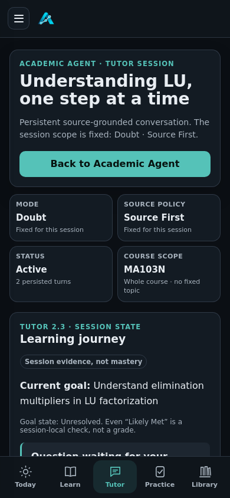
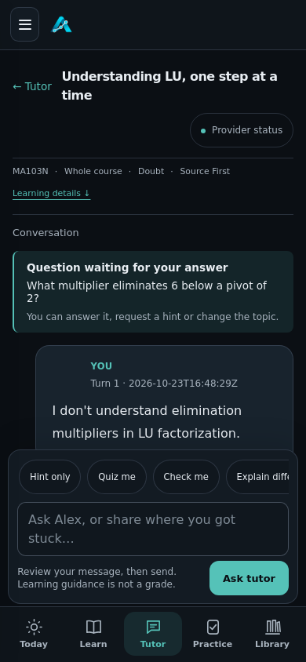

# ANVAYA Tutor UI V3 — Android integration

Draft implementation; no merge authorized. Extends standalone Android #35 and preserves current main's Tutor V2.3 and Smart Verification V1.0. #34/#35 remain unchanged, and Smart Verification V1.1 #37 remains separate.

Start with [audit and contracts](AUDIT.md), [implementation ledger](PLAN.md), [owner specification](SPEC.md).

## Visible changes
Conversation before expandable learning/memory details; distinct You/Alex messages; source/model/feedback disclosures; compact course/topic/mode/source context; fixed auto-growing composer with five explicit-submit follow-ups; real pending diagnostic/exit question continuity; safe local math; retained failed draft and request nonce; latest answer positioned after a successful send. No grades/mastery inference or schema reset.

| 390px baseline | 390px redesigned Tutor |
| --- | --- |
|  |  |

All 360/390/768/1366 screenshots in `screenshots/` are genuine running Chromium + Flask + synthetic SQLite, not mockups. Baseline source is integration 72a2ff2; after captures include the review corrections in the same final feature commit as this file. Timestamp text varies. Native API31 screenshots are separate CI artifacts, not these browser captures.

## Verification record
Baseline 21 tests passed. Initial feature checks: 29 HTTP cases, 15 Chromium journeys, 30 Node contracts. Independent review: 38 focused cases passed; four Important edge cases identified, then corrected. Inline maths and newest-reply regressions each failed before the fix; sticky-context and Mentor-result checks also failed before correction. Focused HTTP/browser/runtime gate before index setup: 29 passed; scripted A–K + UI: 69 passed; local theme/input-width checks: 3 passed; phone runtime/backup/fixture checks with the lexical rebuild: 15 passed; additional simulated provider-failure/retry case verifies safe error text, preserved draft/nonce and zero automatic retry. Synthetic providers test integration, not genuine model quality.

Full/native/Android status is recorded on draft PR #38 and its exact-head Actions artifacts; pending is not a pass. The interrupted first local full run is not counted. Exactly four inherited unavailable private IKS fixtures must remain disclosed skips. No physical owner-phone certification or new live-provider A–K claim.

## Install from your Android phone
1. Open PR #38 → Checks → **Mobile V1.1 standalone Android** → successful final-head run. Open its **android-emulator-<SHA>** artifact after the emulator job passes.
2. Download and extract the ZIP. Use `ANVAYA_Mobile_V1_1_TEST.apk` from that emulator artifact; its SHA256 and source/tree are in `TESTED_APK_SHA256.txt` and `source.txt`.
3. Export a backup from ANVAYA → App & privacy → Manage courses & backups. Keep it outside app storage and verify the backup can be read before any uninstall/clear-storage action.
4. Tap the APK; allow this download app to install unknown apps if Android asks. Package: `in.anvaya.privateapp`, version code 12 / `1.1.1-tutor-ui-v3-test`.
5. If Android reports incompatible signing, retain the installed app and backup first. Debug keys can differ between runners. A same-key update can retain data; no seamless update is promised for a different key. Do not uninstall until your backup is verified.
6. Reopen Tutor. Screenshots and recording are allowed in the real activity. Review private records before sharing.

This is a debug test APK. No public release or repository-committed release signing key. The emulator-installed APK is the authoritative artifact; an independent build job may use a different debug key.

## Local source setup

After adding or restoring PDFs, open App & privacy → Manage courses & backups → **Rebuild local Tutor index**. It builds a lexical index on the phone using production source fingerprints, with canonical SQLite opened read-only. Missing or changed indexes fail closed until rebuilt; no silent model downloads or source-policy bypass. Indexed source answers still need a configured provider when generation is required. An insufficient-evidence response is deterministic, not an offline language model.

## Online AI / privacy
**Online AI remains unavailable in this Android increment.** It is explicitly labelled in Tutor; no API key form, unsafe key persistence, broad outbound exception or embedded CI secret was added. Native Keystore key lifecycle, explicit consent/configuration/test/removal, restricted HTTPS transport, SSRF/redirect/TLS controls and real-provider acceptance remain required. There are therefore no working phone online-AI setup steps yet. Desktop host provider behavior remains available through its existing configuration.

Android still runs Flask/Python/SQLite on the phone, binds random-port loopback, checks capability/Host/Origin/CSRF and rejects external WebView/Python traffic. Saved transcripts and supported deterministic/source study stay offline. No offline generative model, automatic cloud/vault upload or new public server. Existing backup exports remain unencrypted; app-private storage is not database encryption.
