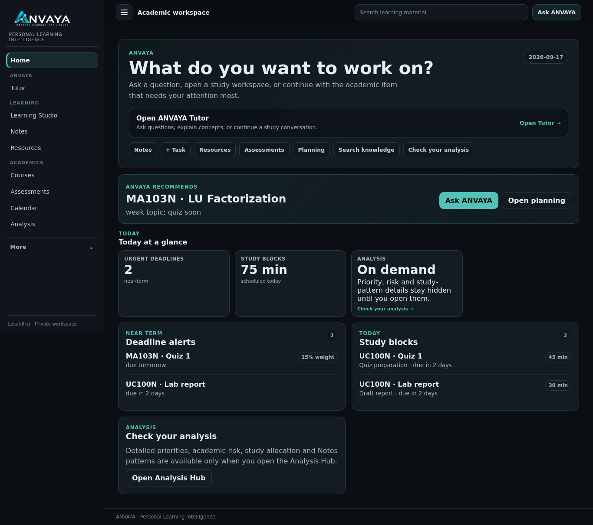
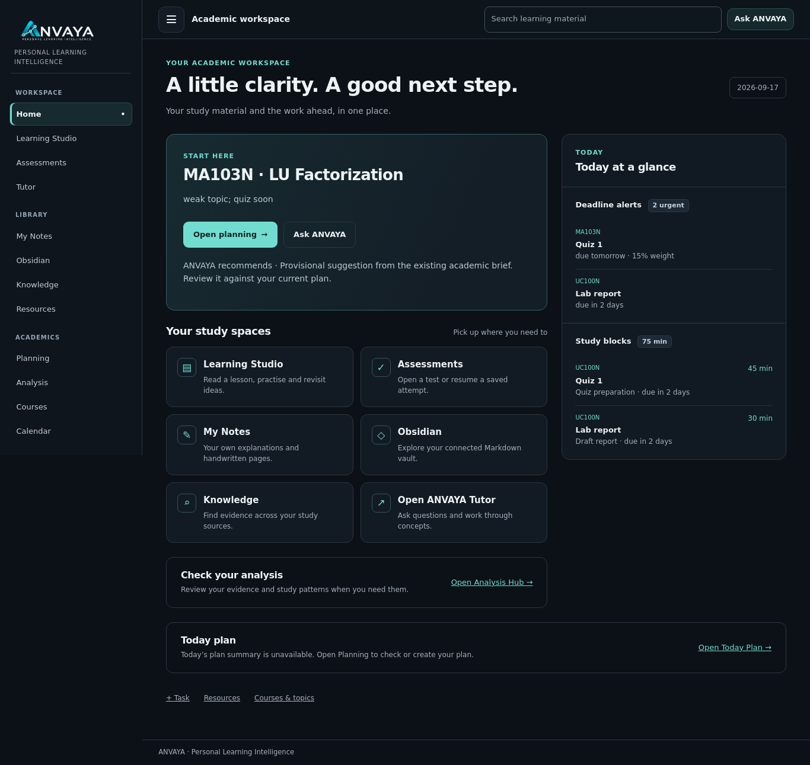

# ANVAYA UI V2 evidence and integration index

**ANVAYA UI V2 — FEATURE BRANCH READY FOR INTEGRATION: NO.** UI and Assessment checks pass on Ubuntu and Windows. The existing strict architecture gate is blocked by four absent external Learning pilot fixtures; this gate remains intact. No merge or deployment.

Runtime-tested source `b19ead6d280c9098b53a637222235407ed28889d`; base `ce2e4e06175f76778f114a85f7552160aeb08a99`. The report/screenshot handoff changes no runtime or test source. Exact counts and run URLs are in [cross-platform acceptance](ANVAYA_UI_V2_CROSS_PLATFORM_ACCEPTANCE.md); the final branch SHA and latest CI are recorded in [draft PR #26](https://github.com/anandpriyadarsi/Personal--AI--Learning-Chatbot/pull/26).

## Actual browser before and after

These are original Flask/Chromium screenshots with disposable synthetic study records. Before source: `7906aa590bb663fffce8090e3d3a0158fa64c02f`; after runtime source: `b19ead6d280c9098b53a637222235407ed28889d`. The baseline was subsequently rebased onto current main without changing protected owners' product files. The complete downloadable archive additionally contains nine surfaces paired at390/1366, extra widths, protected-page proofs, manifests, JUnit, decoded CI logs and independent reviews; open its index.html after extraction. The following committed images remain available if the archive cannot be opened.

| Surface | Before | After |
|---|---|---|
| Home, 1366px | [Original](evidence/before-home-1366.png) | [Original](evidence/after-home-1366.png) |
| Obsidian vault, 390px | [Original](evidence/before-vault-390.png) | [Original](evidence/after-vault-390.png) |
| My Notes, 1366px | [Original](evidence/before-notes-1366.png) | [Original](evidence/after-notes-1366.png) |
| Knowledge, 390px | [Original](evidence/before-knowledge-390.png) | [Original](evidence/after-knowledge-390.png) |

### Home

Before:

After:

## Reviewable implementation reports

- [Baseline and ownership](ANVAYA_UI_V2_BASELINE_AND_OWNERSHIP.md), [implemented design system](ANVAYA_UI_V2_DESIGN_SYSTEM.md), [execution plan](IMPLEMENTATION_PLAN.md)
- [Home acceptance](ANVAYA_UI_V2_HOME_ACCEPTANCE.md), [Obsidian acceptance](ANVAYA_UI_V2_OBSIDIAN_ACCEPTANCE.md), [Notes and Knowledge acceptance](ANVAYA_UI_V2_NOTES_KNOWLEDGE_ACCEPTANCE.md)
- [Per-page implementation/visual matrix](ANVAYA_UI_V2_VISUAL_QA_MATRIX.md), [independent UX review](UX_REVIEW.md), [independent engineering review](ENGINEERING_REVIEW.md)
- [Cross-platform outcomes and four explicit skips](ANVAYA_UI_V2_CROSS_PLATFORM_ACCEPTANCE.md), [preservation and rollback](ANVAYA_UI_V2_PRESERVATION_REPORT.md), [integration steps and deferrals](ANVAYA_UI_V2_NEXT_PHASE_HANDOFF.md)

No real vault, lecture material, personal Notes store, academic database, secrets, or private execution prompt is included. Screenshot paths/configuration refer only to disposable synthetic fixtures. Visual evidence does not certify an installed production deployment or full WCAG conformance.
